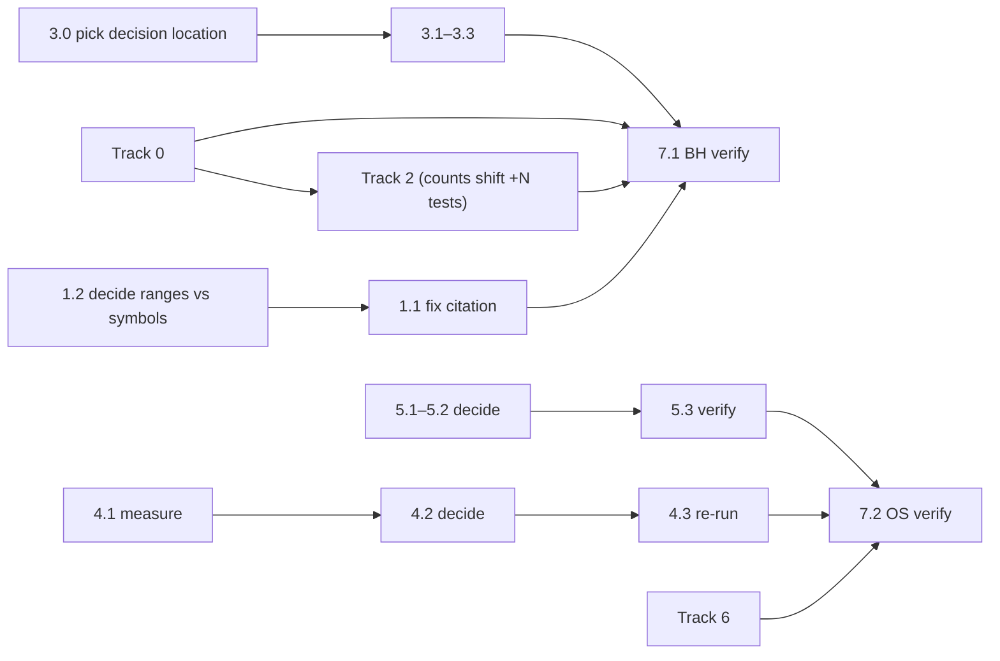

# Follow-up check-gaps plan (v2) — 2026-11-11 EST

> Redraft of `Follow-up check-gaps plan-2026-11-11-EST.md`. Same scope, same gaps. Changes are listed in the **Revision notes** at the end.

## Context

Two independent checks landed 2026-11-11. Both found the work substantially real, and both left a few small gaps:

- **BH corrections check** (BH `2ba3055`): the REA/MemGraphRAG corrections plan execution is substantially real. Parser fixes were proven by a parent-vs-fix comparison on the real files, dossiers were regenerated, the GNN item was fixed, the five-file set passes 39/39, CI is green on all 7 jobs, and the honesty gate held (5.3 is still unticked). Remaining gaps: Tracks 0–3.
- **OS audit-fix check** (OS `bb37fac`): the `01d1ca6` audit fixes are substantially real. The recursion crash is fixed, the suite passes 105/105 with swipl and 91+14 degraded, coverage is 91%, parity is 100%, ruff + mypy are clean, and CI is 11/11 green. Remaining gaps: Tracks 4–6.

This plan closes those gaps. It does not re-open anything either check confirmed.

## Scope and rules

- **Scope: only the gaps listed below.** BH tracks run in the Brain-Harness repo. OS tracks run in the Ontology-Spider repo. Commits stay in their own repo, with no cross-repo commits.
- **Never tick an independent-check box.** That means this plan's **7.3**, plus BH corrections 5.3, check-gaps 6.3, consolidated 7.3, Gephi 4.3 and Harness2 7.3. Each one is ticked only by a separate check session with its own dated report.
- **Evidence rule.** Tick a box only when its annotation has: a commit SHA, the exact command run, the date, the environment (machine, OS, Python), and the output counts. A written decision counts as evidence for decision boxes. A claim in a commit message is not evidence.
- **No new third-party dependencies** without the user's explicit approval. This covers fixture generation too: no installing TensorFlow/h5py just to build test files.
- **Author-machine fallback.** Some boxes need a measurement on the author laptop. If the laptop is not available to the executor, record "laptop not available", measure on this box and in CI, and leave the laptop part as an explicit open item. Do not estimate the laptop numbers.
- **Large refactors are out of scope.** Any box that offers "split it now" defaults to *record + mechanically enforce*. A split gets its own plan.

## Execution order

BH (Tracks 0–3) and OS (Tracks 4–6) are independent and can run in parallel.

## Track 0 — BH: give the real-file test signal (corrections 2.2)

The corrections check found the real-file test vacuous in CI. The laptop-path branches are `if Path(r"D:\GitHub\...").exists():` with no `else` and no assertions, so off the laptop the test asserts nothing and passes trivially. The real-file behavior verified live (TFLite 7 tensors / 0 junk; H5 4 tensors), but the committed test cannot catch a regression in CI.

- [ ] **0.1 Verify the branch structure.** Read the laptop-path branches in `tests/test_service_rea_toolkit.py`. There are 4 reported hits, at lines 422, 450, 475 and 492; verify each one. Record which are guard-only (no `else`, no assertions) and which formats they cover (TFLite, H5, protobuf, TF.js).
- [ ] **0.2 Give the test signal in CI, using vendored minimal fixtures.** Commit small fixtures under `tests/fixtures/rea_model_artifact/`, one per format that 0.1 shows is uncovered. They should reproduce the structures the fix targets (for example the TFLite junk-tensor case and the H5 tensor layout). Build them byte-level, or truncate them from the real files, with no new dependencies. Keep each under ~64 KB, and record each fixture's provenance (derived from which real file, or synthesized to which spec) in a fixture README. Assert exact tensor counts/names, not just "non-empty".
  - *Not acceptable:* `else` branches that fail when the laptop files are absent. They make CI permanently red, because CI never has those files. Also not acceptable: a bare `pytest.skip`, which is still vacuous in CI. The laptop-path branches may stay as an extra local check, but they cannot be the signal.
  - If a fixture can't be made small or redistributable (licensing/size), record that per format as a written decision and say which assertion stands in for it.
- [ ] **0.3 Prove the test can fail.** Swap in the pre-fix parser (the parent of the parser-fix commit; name the SHA). Show the fixture tests **failing**, then **passing** on the fix. Do this in a clean checkout with the laptop paths absent, which is CI conditions. Record both runs and the CI job URL/SHA where the new tests run.

## Track 1 — BH: fix the already-stale citation (corrections 4.1)

The 4.1 fix (60-400 → 60-412) landed as instructed, but the same commit grew `model_artifact.py` from 412 to 507 lines. The range now misses parsers that claim_002 names. Verified at `2ba3055`: `_parse_tflite` 245, `_parse_hdf5` 378, `_parse_protobuf_model` 417, `_parse_tfjs_shard` 454–507.

- [ ] **1.2 (do first) Decide line ranges vs symbol names.** Record a written decision: keep line ranges and accept that they re-stale on every parser change, or cite parser symbol names (`model_artifact.py::_parse_tflite` …). Symbol names are recommended, because Track 3.3 expects this file to keep growing.
- [ ] **1.1 Apply the decision.** Edit `.harness/knowledge/ki_self_20261110_01_rea_managed_serialization_and_memgraphrag_partition_invariant/metadata.json:69` to either `model_artifact.py:60-507` or the four symbol names. `summary.md` has no `model_artifact` citation today, so record that as a no-op and don't invent one. Then run the vault/KI validator and the drift check, and record that they pass. The item must still satisfy the dual-file format.

## Track 2 — BH: reconcile the gate figures (corrections 5.2)

The 5.2 evidence cites "2,210 passed, 0 failed, 862 deselected in 233.23s" (2,210 + 862 = **3,072** collected) and "3,072 tests, 3,071 passed, 1 skipped, 0 failed". The independent check got **11 failed / 2132 passed / 69 skipped / 839 deselected**, twice. That is **3,051** collected, 21 fewer. The 11 failures are the known pre-existing set, and passed is +1 vs `0c97c29`'s 2131. So the substance of 5.2 holds, but "0 failed" and the collection total don't reproduce on this box. The environment cause (bare `python` on PATH, proxy-mangled fetcher URLs, missing magika model) is an inference, not a verified fact.

- [ ] **2.1 Record reproducible figures per environment** for the author machine (or the fallback), this box, and CI: collected, passed, failed, skipped, deselected and duration, with the environment named. Run after Track 0 lands and state the expected delta (+N new fixture tests).
- [ ] **2.2 Name the 11 pre-existing failures** by full node ID in the 5.2 evidence, with a one-line verified cause for each (or "cause unverified"). Grouped by area, they are: transport stderr drain ×2, fetcher bounds/cache/remote-zip ×3, magika ×1, repo-triad ×2, ingestion PyPI/GitLab ×3.
- [ ] **2.3 Reconcile the collection totals.** Explain the 3,072 vs 3,051 gap by diffing `pytest --collect-only -q` between environments (for example, modules that fail to import or are skipped at collection). Either explain the "3,072 / 0 failed" full-run claim or correct it, as an annotated correction, not a silent edit.
- [ ] **2.4 Record which environment is authoritative** for the gate (CI, following the bench decision's precedent) and why the figures differ, as a written note in the plan.

## Track 3 — BH: record the deferred decisions durably

Three decisions from the corrections execution are recorded only in places that will be lost when the plan is archived (a plan annotation, a commit message, a test comment).

- [ ] **3.0 Pick one durable location** for all three decisions, such as the repo's existing decision/ADR log or a new `docs/decisions/rea-size-exemptions.md` if none exists. Link to it from a code comment at the top of each affected file.
- [ ] **3.1 `rea_toolkit.py` deferral trigger.** Record the 2,200-LOC split trigger for `src/harness/services/rea_toolkit.py` (currently 1,906 lines), with the reason. Today it lives only in the corrections plan annotation and the `f0460de` message; a grep of `src/`, `plugins/`, `docs/` and the ki_self item finds nothing.
- [ ] **3.2 `managed_pe.py` exemption.** Record the exemption for `plugins/security_and_forensics/rea_managed_runtime/engine/managed_pe.py` (335 lines, "pre-existing legacy PE/CLI parser; out of scope for cf0300a") in the same place as 3.1.
- [ ] **3.3 `model_artifact.py` (507 lines).** Record the exemption with a trajectory note (each precision fix adds ~100 lines) and a numeric re-trigger.
- [ ] **3.4 Enforce the triggers mechanically.** In the existing line-bounds test, turn each exemption into a capped one, for example `{"rea_toolkit.py": 2200, "managed_pe.py": 400, "model_artifact.py": 600}`, and point the failure message at the decision note. A prose trigger that nothing checks will be missed. Prove it trips by temporarily lowering one cap, and record that run.

## Track 4 — OS: fix the memory-test bound (audit-fix gap 1)

`test_large_chain_query_memory_bounded` (`tests/test_mcp.py:614`, `assertLessEqual(elapsed, 10.0)`; the "~8.5s under coverage" comment is at line 612) took **15.98s under coverage on this box**. A plain run takes 3.10s, and CI Coverage is green. This is a slow-box flake, not a CI blocker, but the comment is refuted.

- [ ] **4.1 Measure.** Take plain and coverage timings on the author machine (or the fallback), this box and CI. Use at least 3 runs each and record min/median/max.
- [ ] **4.2 Decide one, in writing:**
  - (a) raise the bound to the measured coverage max + a stated margin, citing the numbers; or
  - (b) apply the wall-clock bound only in plain runs (detect coverage via `sys.gettrace()`/an env flag) and keep the strict bound there; or
  - (c) record that CI is authoritative and the local failure is expected.
  - In every case, replace the "~8.5s" comment with the measured figures and date. Also note that the test is named *memory* bounded but asserts *time*. Either record that the time bound is a proxy, or add a `tracemalloc` peak assertion (stdlib, no new dependency).
- [ ] **4.3 Re-run the coverage suite** after the change, on this box and in CI, and record the results.

## Track 5 — OS: lint/type scope honesty (audit-fix gaps 3–4)

- [ ] **5.1 Format.** `ruff format --check src tests` flags 31 files (verified at `bb37fac`; it was 39 before `01d1ca6`). CI enforces only `ruff check`. Pick one: add `ruff format --check src tests` to the Lint & Type Check job and reformat in a **separate, format-only commit** (so blame/review stay clean), or record that only `ruff check` is enforced. Do one, in writing.
- [ ] **5.2 Correct the mypy scope claim.** CI runs `mypy src`, but the `01d1ca6` message says "across src and tests". Either expand CI to `mypy src tests` and fix what that turns up, or record the correction in `docs/decisions.md`. Commit messages can't be edited, so the correction has to be written down. Record which option was chosen.
- [ ] **5.3 Verify live** with `ruff check src tests`, `ruff format --check src tests` and `mypy <decided scope>`, locally and in CI, and record the outputs.

## Track 6 — OS: record the behavior decisions (audit-fix gap 5)

`docs/decisions.md` (latest is §7.12, line 183) has no records for `01d1ca6`'s behavior changes.

- [ ] **6.1 Add §7.13 (or the next free section)** recording: the iterative BFS `get_all_superclasses` and the iterative Tarjan SCC (why iterative, which semantics were preserved, and which test proves equivalence); `Session.retract_assertion` now returning `bool`; the runner `ValueError` for an unsupported transport (a behavior change the commit message doesn't mention); and `Explanation` gaining `to_dict` (a superset, not a pure move). Give each entry the test that pins it, or note "no test", which then becomes a follow-up item.
- [ ] **6.2 Bench lattice note.** The 1500ms budget (§7.12, CI authoritative) was exceeded on some review-box runs at both `25e80b8` and `bb37fac` (856–2692ms, 3x variance, nothing attributable to `01d1ca6`). Either add a dated confirmation to §7.12 or adjust the calibration. Record the choice.

## Track 7 — Verification

- [ ] **7.1 Re-run the BH checks live**: the five-file REA+MemGraphRAG set, the unit gate, lint + govern + drift. Record exact counts against the `2ba3055` baseline (11 failed / 2132 passed / 69 skipped / 839 deselected) and **explain every delta** (expected: +N passed from Track 0, +tests from 3.4, failures unchanged at the named 11).
- [ ] **7.2 Re-run the OS checks live**: the suite in both modes, a coverage run including the memory test, ruff + mypy at the decided scope, and parity. Record exact numbers against the `bb37fac` baselines (105 passed / 91+14 degraded, coverage 91%, parity 100%) and explain every delta.
- [ ] **7.3 Independent check.** A separate check session with its own dated report verifies Tracks 0–6 against code and tests. **The executor never ticks this box.**

---

## Revision notes (v1 → v2)

| # | Change | Why |
|---|--------|-----|
| 1 | 0.2 now requires vendored minimal fixtures and rules out the "`else` asserts fail" option | Under v1's alternative, CI goes permanently red because CI never has the laptop files. A skip stays vacuous. Only fixtures give a CI signal, which is what 0.3 requires |
| 2 | 0.2 bans dependency-built fixtures and adds size/provenance requirements | Without this, the no-new-dependencies rule could be broken through fixture tooling |
| 3 | Merged the two duplicate "don't tick 7.3" rules into one list | v1 stated the rule twice, and the first list left out this plan's own 7.3 |
| 4 | Track 1 order: decide (1.2) before editing (1.1), plus a validator/drift run | Choosing symbol names makes the range edit wasted work |
| 5 | Added 2.3: reconcile 3,072 vs 3,051 collected | v1 missed the 21-test collection gap, which is evidence of an environment difference in its own right |
| 6 | Added 3.0 (single location) and 3.4 (caps in the line-bounds test) | v1's "decision note or code comment" was vague, and prose triggers aren't enforced |
| 7 | 3.3 defaults to record + enforce; splitting is out of scope | Avoids a refactor inside a gaps plan |
| 8 | 4.2 adds the coverage-aware bound option and flags the memory-vs-time naming mismatch | Timing assertions under coverage are inherently flaky |
| 9 | 5.1 asks for a format-only commit and an explicit `src tests` scope; 5.2 notes commit messages can't be edited | Keeps review clean, and makes the correction concrete |
| 10 | Stricter evidence fields, author-machine fallback, execution-order diagram, and "explain every delta" in Track 7 | Removes ambiguity about what makes a box tickable, and covers the case where the laptop isn't available |
