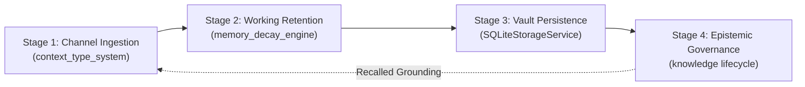

# Learning-Core Lifecycle: The Endogenous Cognitive Loop

## Overview

The Harness learning core unifies runtime prompt generation, working-memory decay, epistemic knowledge retention, and multi-state lifecycle governance into a closed-loop endogenous learning pipeline. Rather than treating memory as an unstructured string buffer or append-only log, the learning core enforces typed channel boundaries, mathematical forgetting curves, cryptographic Isnad provenance, and state machine promotion.

---

## The 4-Stage Endogenous Cognitive Loop



---

## Stage-by-Stage Breakdown

### Stage 1: Channel Provenance & Trust Gate (`context_type_system`)
Raw observations entering the agent loop are partitioned into four immutable semantic channels:
- `instruction`: Task goals and operational directives.
- `tool_output`: Unsanitized results from subprocesses, shell commands, or network calls.
- `evidence`: Verified facts and structural test observations.
- `memory`: State recalled from historical episodes or knowledge vaults.

**Security Policy**: Raw `tool_output` is strictly quarantined. It can **never** transition directly to `instruction` (eliminating prompt injection vectors) and can only elevate to `evidence` through deterministic validation:
```bash
# Register instruction and raw tool output
harness context add --session run-1 --type instruction --content "Refactor database pool"
harness context add --session run-1 --type tool_output --content '{"status": "ok"}' --source "pg_stat"

# Elevate tool output to verified evidence
harness context validate-tool --session run-1 --output-json '{"pool_size": 20}' --strict

# Render budgeted prompt
harness context assemble --session run-1 --budget-tokens 4000
```

---

### Stage 2: Working-Memory Retention & Decay (`memory_decay_engine`)
Active items in conversational memory decay across logical turns according to the Ebbinghaus retention curve:
$$R(t) = \exp\left(-\frac{\Delta t}{S / m_{\text{channel}}}\right)$$

- **Channel Decay Multipliers**:
  - `instruction`: $0.25\times$ (retained 4x longer than baseline)
  - `foundational`: $0.35\times$ (exempt from eviction when `is_foundational=True`)
  - `evidence`: $0.70\times$ (slow decay)
  - `memory`: $1.00\times$ (standard decay)
  - `tool_output`: $1.75\times$ (fast decay, soft-evicted quickly)
- **Soft Eviction**: When retention $R(t) < 0.20$, the item is soft-evicted (`item.evicted = True`). It drops out of `working_set()` but is never destroyed, remaining accessible for post-hoc analysis.
- **Monotonic Stability Growth**: Each explicit recall event reinforces stability:
  $$S_{\text{new}} = S_{\text{old}} \cdot (1 + \ln(1 + n_{\text{recalls}}))$$

```bash
# Register memory with channel weighting
harness memory register --key "db-invariant" --content "Max connection pool is 20" --channel instruction --foundational

# Step turns
harness memory step --turns 5

# Recall reinforces stability
harness memory recall "db-invariant"

# Inspect active vs soft-evicted working set
harness memory working-set --ranked
harness memory working-set --include-evicted
```

---

### Stage 3: Epistemic Vault Persistence (`SQLiteStorageService` / Knowledge Vault)
High-stability evidence and architectural invariants that outlive individual sessions are promoted to permanent dual-file items in `.harness/knowledge/<ki_id>/`:
- `metadata.json`: Contains structured identifiers, category, tags, references, and `isnad` chains.
- `summary.md`: Distilled narrative guidelines and empirical heuristics.

```bash
# Query Knowledge Vault
harness knowledge query "connection pool"

# Joint query across epistemic knowledge items and procedural skills
harness knowledge joint-query "database" --json
```

---

### Stage 4: Epistemic Lifecycle Governance (`epistemic-memory-lifecycle`)
Knowledge items are actively governed through an 8-state state machine:
`CANDIDATE` → `PROBATIONARY` → `VERIFIED` → `CANONICAL` → `DISPUTED` → `DEPRECATED` → `SUPERSEDED` → `ARCHIVED`.

Items that are superseded (via `supersedes` edges) or contradicted by newer empirical findings are automatically flagged and retired without loss of history:
```bash
# Audit vault contradictions and supersessions
harness knowledge contradictions

# Inspect lifecycle status distribution
harness knowledge lifecycle
```

---

## Architectural Summary

| Phase | Engine | Responsibility | Primary Artifact |
|---|---|---|---|
| **1. Ingestion & Gate** | `context_type_system` | Channel segregation, origin ledger, token budgeting | `ContextItemModel`, Assembled Prompt |
| **2. Retention & Decay** | `memory_decay_engine` | Ebbinghaus curve, soft eviction, stability growth | `WorkingSet`, Memory Snapshot |
| **3. Epistemic Vault** | `SQLiteStorageService` | Canonical dual-file persistence, Isnad chains | `metadata.json`, `summary.md` |
| **4. Lifecycle Governance**| `harness knowledge` | Contradiction detection, 8-state promotion | `ContradictionReviewItem`, Audit Report |

See the [CLI Reference](../reference/cli.md) and [Memory Architecture](./memory-architecture.md) for related configuration and commands.

