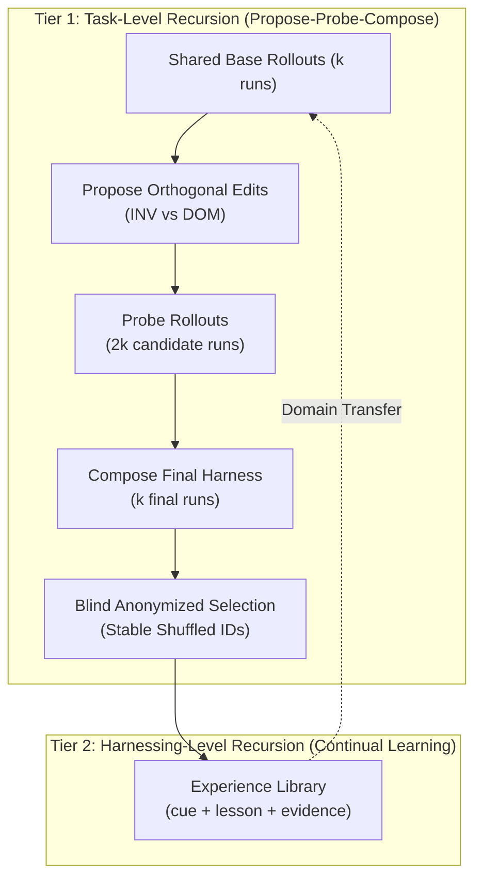

# Recursive Agent Harnessing (Harness²)

## Overview

**Recursive Agent Harnessing** (`Harness²`, based on Xu et al., Google Cloud AI Research & Northwestern University, arXiv:2610.14224) formalizes recursive self-improvement for open-world AI agents where task verifiers, rubrics, and ground-truth answer keys are absent. 

While conventional agent refinement either fine-tunes underlying neural weights or relies on static prompt scaffolds, recursive harnessing **keeps model weights frozen** and iteratively evolves the *execution harness* itself—the always-on guidance files, on-demand skills, deterministic helper scripts, and sub-agent architectures that wrap the model.

---

## The Two Recursion Tiers



### 1. Task-Level Recursion: Contrastive Propose-Probe-Compose
- **Propose**: Partitions candidate modifications into two orthogonal dimensions:
  - **Invariant (`INV`)**: How the agent works (tool failure recovery, deterministic helper scripts in `scripts/`, auto-triggered skills, sequencing).
  - **Domain (`DOM`)**: What a domain expert knows (deliverable contracts, cross-field consistency, validation heuristics, terminology).
- **Probe**: Evaluates each proposal in isolated trial rollouts on the target task.
- **Compose**: Synthesizes the final harness from behavioral contrasts across trajectories, either via parallel aggregation (`agg`, width-first) or sequential iterative depth (`seq`, depth-first).
- **Blind Selection**: Selects final deliverables through anonymized, label-shuffled identifiers (`A`, `B`, `C`...) to eliminate provenance bias, falling back to delivered base executions upon selector failure.

### 2. Harnessing-Level Recursion: Domain Experience Library
Retains successful full component trees and transferable heuristic triples (`cue`, `lesson`, `evidence`) within a persistent per-domain experience library (`context/library/`). Future tasks in the same domain draw upon these verified harnesses as reference baselines.

---

## Strict Dual-Mode Budget Accounting ($R=4k$, $P=3k$)

To guarantee reproducible, bounded compute expenditures, every recursive adaptation run adheres to the strict mathematical budget identity:

$$R = 4k \quad \text{and} \quad P = 3k$$

Where:
- $k$ is the user-specified recursion multiplier.
- **Rollouts ($R = 4k$)**: $k$ shared base rollouts + $2k$ candidate probe rollouts ($k$ INV + $k$ DOM) + $k$ final composition rollouts.
- **Improvement Sessions ($P = 3k$)**: $k$ INV proposal sessions + $k$ DOM proposal sessions + $k$ composition sessions.

Duplicate run and session labels are explicitly detected and rejected before count verification, preventing candidate loss from silent file overwrites.

---

## Fail-Closed Evidence Isolation

Under open-world conditions, preventing answer-key leaks and evaluator verdict contamination is critical:
- **Answer-Key Tripwires (`assert_no_leak_paths`)**: Scans workspace and context trees against benchmark-declared answer globs (e.g. `*.solution`, `answer_key.*`), aborting before model invocation.
- **Grader Verdict Tripwires (`assert_no_verdicts`)**: Scans candidate artifacts and evidence directories in overlapping chunks for grader signatures and rubric tokens, failing closed if evaluation artifacts leak into model input.
- **POSIX Trial Identity Fingerprinting**: Generates SHA-256 fingerprints across tree files, script contents, and task input digests to ensure trial reproducibility.

---

## CLI Inspection Seams (`harness refine`)

The `harness refine` CLI command group provides headless introspection and deterministic verification seams:

### 1. Budget Verification (`harness refine budget`)
Calculate the exact $R = 4k$ rollout and $P = 3k$ session allocations:
```bash
harness refine budget --k 2
```
```json
{
  "k": 2,
  "rollouts": 8,
  "sessions": 6
}
```

### 2. Editable Surface Validation (`harness refine validate`)
Validate an agent workspace or repository against surface constraints, Rule 11 bounds, and catalog character caps:
```bash
harness refine validate . --brain
```
```json
{
  "valid": true,
  "census": {
    "always_on_chars": 27489,
    "n_files": 218,
    "skills": 106,
    "sub_agents": 0,
    "scripts": 0
  },
  "off_surface": [...]
}
```

### 3. Evidence Leak Scan (`harness refine scan`)
Execute answer-key and grader verdict tripwires across an evidence tree:
```bash
harness refine scan /path/to/evidence --leak-glob "*answer*"
```
```json
{
  "clean": true,
  "root": "/path/to/evidence"
}
```

### 4. Harness Fingerprinting (`harness refine fingerprint`)
Compute deterministic trial fingerprints:
```bash
harness refine fingerprint .
```
```json
{
  "path": ".",
  "fingerprint": "a1b2c3d4..."
}
```

### 5. Deterministic Demo (`harness refine demo`)
Run both parallel and sequential recursive harnessing modes end-to-end on deterministic test tasks without external model credentials:
```bash
harness refine demo --output ./demo_run --k 1 --mode both
```

---

## Current Scope & Deferral Boundaries

In accordance with architectural design decisions:
- **Deterministic Inspection & Demo Active**: Budget allocation (`budget`), surface validation (`validate`), tripwire scanning (`scan`), trial fingerprinting (`fingerprint`), and credential-free demo sweeps (`demo`) are fully active and integrated into the core CLI.
- **Live Proposer & `refine run` Deferred by Design**: Live model-backed proposing via external LLM provider APIs and the `harness refine run` command are deferred by design. Reopening trigger: scheduling of automated multi-turn live evaluation benchmark suites within the CI pipeline.

---

## Related Documentation

- [Agent Architecture Reference](../reference/agent.md)
- [Plugin Architecture Hub](../../plugins/README.md)
- [Micro-Kernel & IoC Architecture](../EXPLANATION.md)

