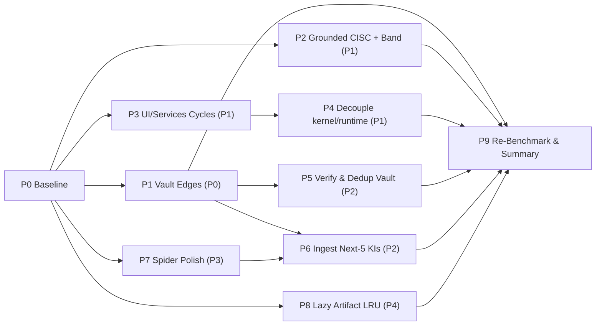

# Ontology-Spider Decision Experiments — Follow-Up Action Plan

> **Audience:** a coding agent executing top-to-bottom, left-to-right.
> **Evidence baseline:** [experiments/spider_decisions/REPORT.md](REPORT.md) (Run 1 at commit `1340981`; Run 2 human-shortlist Phase 4 + report refresh at commits `eef2f6a` and `d2e6e6f`).
> **Planner notes:** Steps are written to be mechanical and verifiable. Where judgement is required, the step is marked 🧑 **HUMAN CHECKPOINT** (stop and wait for user input) or ⚠️ **ESCALATE** (hand back to a high-reasoning model).

---

## 0. How to Use This Plan (read every session)

### Resume protocol
1. Open this file and locate the **first unchecked box** in the Progress Tracker (§1).
2. Jump to that phase and find its first unchecked step box.
3. Verify the phase's **Depends on** outputs and disk inputs exist before starting; if an input is missing, uncheck the producing step and fix it first.
4. Design every edit and script to be **idempotent** so re-running a step cleanly converges.
5. Tick a box (`- [ ]` → `- [x]`) **only after** its acceptance check passes. Tick the phase in §1 only after **all** steps and its Acceptance section pass.
6. At the end of every phase: append an entry to `experiments/spider_decisions/ACTION_LOG.md` (created in Phase 0) and create a **local** commit `feat(spider-followup): phase N <title>`. **Do not push** unless the user explicitly asks.

### Hard rules (from `AGENTS.md` — non-negotiable)
- **Never** edit `.harness/knowledge/**` unless a step explicitly says so **and** a 🧑 **HUMAN CHECKPOINT** has approved the exact batch first. Always preserve canonical dual-file format (`metadata.json` + `summary.md`, Rule 40).
- **Never** modify `src/harness/kernel/**` outside **Phase 4**, and never mutate `ServiceContext` constructor contracts or IoC lifecycle signatures (Rule 19).
- **Never** read, print, or log `D:\GitHub\projects\Tokens\tokens.txt`. No network calls are needed for this plan.
- **Never** run multi-line Python via `python -c` (Rule 29). Write a script or scratch file and execute it with `.venv\Scripts\python.exe <script>`.
- Configure UTF-8 standard streams (`sys.stdout.reconfigure(encoding='utf-8')`, `sys.stderr.reconfigure(encoding='utf-8')`) and `sys.path` in every standalone script (Rules 23, 50).
- When saving machine-parsed PowerShell output, use `| Out-File -Encoding utf8`, never bare `>` (Rule 26).
- Run pytest with explicit file paths or `-k "<pattern>"`, never `tests/test_*.py` globs (Rule 30).
- Use `@dataclass(slots=True, frozen=True)` for new value objects (Rule 12); follow inspect-before-edit and write failing tests first (Rule 13).
- Remain a **read-only observer** of `D:\GitHub\cloned\**`. Never write or modify anything there.

### Human checkpoint size rule (mandatory)
A 🧑 **HUMAN CHECKPOINT** must never present the user with a single list longer than 8 items to choose from or approve at once. Partition larger review sets into batches/shortlists of `<= 8` items each; if a partition has a single candidate, record it as a forced pick instead of asking.

### Negative Scope — What NOT to Build (proven by `REPORT.md`)
- **Do NOT add unweighted KI-tag boosts to `BuiltinSkillRegistryService.route_intent()`.** Baseline already scores `95.0%` Hit@1 / Hit@3 (`results/p10/summary.md`); unweighted `+1`-per-KI boosts dropped Hit@1 to `65.0%` via high-degree tag hubs (`ai-agent-engineer`, `epistemic-memory-lifecycle`, `architecture-deepening-workflow`).
- **Do NOT build a syntactic `python + tests + packaging` plugin-vs-KI classifier.** Syntactic attributes predicted only `2/14` (`14.3%`) repos accurately (`results/p08/summary.md`); pluginization depends on architectural domain fit across TS/Go/research/docs repos.

### Standard commands
```powershell
# Python interpreter (always)
.venv\Scripts\python.exe <script>

# Code & formatting gates
.venv\Scripts\python.exe -m ruff check .
.venv\Scripts\python.exe -m ruff format --check experiments/spider_decisions
```

### ⚠️ Escalation triggers (stop and hand back to a high-reasoning model)
- Any architectural refactor (especially Phase 4 `kernel/runtime/`) touches public contracts or introduces circular imports not resolved within 2 attempts.
- Any pre-existing test fails unexpectedly after a change and the cause is not obvious within 2 attempts.
- Threshold calibration (Phase 2) or evaluation metrics regress relative to the `REPORT.md` baseline.

---

## 1. Progress Tracker

- [x] **Phase 0** — Baseline verification & `ACTION_LOG.md` scaffolding
- [x] **Phase 1** — P0: Vault `references_code` backfill & module-ID edge normalization (`0.33 -> >= 0.85` F1)
- [x] **Phase 2** — P1: Evidence-grounded CISC swarm voting & ASPEST confidence-band escalation
- [x] **Phase 3** — P1: Break `ui <-> commands` cycle & `services/` upward leaks (zero kernel edits)
- [x] **Phase 4** — P1 (Arch): Decouple `kernel/runtime/` composition root & verify SCC reduction
- [x] **Phase 5** — P2: Vault hygiene — verify top-8 central unverified KIs & triage 12 duplicate pairs
- [x] **Phase 6** — P2: Ingest Next-5 research targets (`dp_sgd_clipping`, `smart_eval`, `perturbations`, `norml`, `psycholab`)
- [x] **Phase 7** — P3: Polish `ontology_spider` — zero residual false bridges, reverse blast radius & uncapped self-scan
- [x] **Phase 8** — P4: Dual-capped LRU eviction & bounded prefetch for lazily-staged plugin artifacts
- [x] **Phase 9** — Final re-benchmark, quality gates & `ACTION_SUMMARY.md`

### Why this order

- **Schema/edge normalization before vault writes.** Fixing `adapter.py` edge normalization and backfilling canonical `references_code` links (Phase 1) ensures Phases 5 and 6 verify and author KIs using the canonical module-ID format.
- **Zero-kernel seams before kernel extraction.** Decoupling `ui -> commands` and `services -> commands/creator` (Phase 3) isolates the composition root cleanly before touching `src/harness/kernel/runtime/` (Phase 4).
- **Spider polish before new ingestion.** Fixing the residual false bridges (`gvisor/shim`, `gvisor/governance`), reverse blast radius, and uncapped file scans (Phase 7) sharpens validation before Phase 6 refreshes `grm` and Phase 9 re-runs the full benchmark suite.

---

## Phase 0 — Baseline Verification & Action Log Scaffolding

**Goal:** Lock in a green baseline across all affected test suites and initialize `experiments/spider_decisions/ACTION_LOG.md`.

**Depends on:** nothing. **Model tier:** low.

### Steps
- [x] **0.1** Create `experiments/spider_decisions/ACTION_LOG.md` with header `# Spider Follow-Up Action Log` and this per-phase template comment:
  ```markdown
  <!--
  ## Phase N — <title> (<ISO timestamp>)
  - Outcome: PASS | FAIL | PARTIAL
  - Key metric(s): ...
  - Changes: ...
  - Verification: ...
  -->
  ```
- [x] **0.2** Verify required experiment inputs exist on disk:
  `experiments/spider_decisions/REPORT.md`, `experiments/spider_decisions/results/p02/unverified_priority.md`, `experiments/spider_decisions/results/p02/duplicate_review_sheet.md`, `experiments/spider_decisions/results/p04/human_picks.json`, `experiments/spider_decisions/results/p06/edge_backfill_proposal.md`, `experiments/spider_decisions/results/p07/memo_q1.md`, `experiments/spider_decisions/results/p07/memo_q2.md`, `experiments/spider_decisions/results/p09/summary.md`, `experiments/spider_decisions/results/p11/summary.md`.
- [x] **0.3** Run baseline quality gates:
  ```powershell
  .venv\Scripts\python.exe -m ruff check .
  .venv\Scripts\python.exe -m pytest tests/test_repo_ontology_seam.py tests/test_ontology_spider_service.py tests/test_ontology_spider_adapter_fixes.py tests/test_swarm_cisc_integration.py tests/test_uncertainty_cisc_calibration.py tests/test_ui_server.py tests/test_service_storage_vault_integrity.py -q
  ```
- [x] **0.4** Append Phase 0 entry to `experiments/spider_decisions/ACTION_LOG.md` and make a local commit `feat(spider-followup): phase 0 baseline and action log`.

### Outputs
`experiments/spider_decisions/ACTION_LOG.md`.

### Acceptance
- All baseline `ruff` and `pytest` checks pass with zero errors.

---

## Phase 1 — P0: Vault `references_code` Backfill & Module-ID Edge Normalization

**Goal:** Lift module-level KI graph retrieval from `0.3333` F1 (`results/p06/metrics.json`) to `>= 0.85` F1 without losing `1.00` precision, by normalizing code-target edges in `adapter.py` and backfilling the 12 missing canonical `references_code` edges proposed in `results/p06/edge_backfill_proposal.md`.

**Evidence baseline:** `results/p06/metrics.json` (`hop0` P/R/F1 `0.40/0.25/0.28`; `hop1` `0.40/0.30/0.3333`), `results/p06/edge_backfill_proposal.md` (`6/13` gold KIs lack `references_code`; existing edges use `src_*_py` or `applicable_to`).

**Depends on:** Phase 0. **Model tier:** low for adapter/tests; human checkpoint for vault writes.

### Steps
- [x] **1.1** Inspect `_extract_item_and_edges()` and `_sanitize_identifier()` in `plugins/memory_and_epistemics/ontology_spider/adapter.py`, plus `experiments/spider_decisions/retrieval.py` and `experiments/spider_decisions/p06_eval_retrieval.py`.
- [x] **1.2** Add failing tests in `tests/test_ontology_spider_adapter_fixes.py`:
  - `test_code_edge_normalizes_src_module_paths` — a KI edge (`references_code` or `applicable_to`) targeting `src/harness/services/uncertainty_guard.py` or `src/harness/services/deep_auditor/__init__.py` emits a canonical `references_code` relation to `harness_services_uncertainty_guard` / `harness_services_deep_auditor` while preserving the original assertion.
  - `test_code_edge_strips_src_prefix_and_py_suffix` — pre-sanitized targets like `src_harness_services_uncertainty_guard_py` also emit canonical `harness_services_uncertainty_guard`.
- [x] **1.3** Implement canonical module-ID normalization in `plugins/memory_and_epistemics/ontology_spider/adapter.py` (narrow helper converting `src/<pkg>/<mod>.py` or `src_<pkg>_<mod>_py` and package `__init__.py` paths on `references_code`/`applicable_to` edges into canonical `<pkg>_<mod>` module targets without breaking existing relations).
- [x] **1.4** 🧑 **HUMAN CHECKPOINT (2 batches of 6 `<= 8`)** — Present the 12 proposed edges from `experiments/spider_decisions/results/p06/edge_backfill_proposal.md` in two batches of 6:
  - **Batch A (rows 1–6):** `ki_google_research_cisc_confidence_voting`, `ki_google_research_uq_benchmark_2019_calibration_shift`, `ki_njoku_uncertainty_aware_systems` → `harness_services_uncertainty_guard`; `ki_20260831_strategify_04`, `ki_audit_20260908_03`, `ki_google_research_cisc_confidence_voting` → `harness_agent_swarm_consensus`.
  - **Batch B (rows 7–12):** `ki_self_20260831_01` → `harness_agent_swarm_consensus`; `ki_self_20261109_01_*`, `ki_self_20261109_02_*`, `ki_self_20261109_04_*` → `harness_services_ontology_spider`; `ki_self_20260907_01`, `ki_self_20261114_08_*` → `harness_services_deep_auditor`.
  Apply **only** user-approved `references_code` edges to each `.harness/knowledge/<ki_id>/metadata.json`.
- [x] **1.5** Refresh `experiments/spider_decisions/results/snapshots/vault.json` and re-run `experiments/spider_decisions/p06_eval_retrieval.py`. Record updated macro P/R/F1 vs `0.40/0.30/0.3333`.
- [x] **1.6** Run quality gates (`ruff check .`, `pytest tests/test_ontology_spider_adapter_fixes.py tests/test_ontology_spider_service.py tests/test_service_storage_vault_integrity.py -q`), append `ACTION_LOG.md`, local commit `feat(spider-followup): phase 1 backfill references_code and normalize module edges`.

### Outputs
Updated `plugins/memory_and_epistemics/ontology_spider/adapter.py`, new tests in `tests/test_ontology_spider_adapter_fixes.py`, approved `references_code` edges in `.harness/knowledge/*/metadata.json`, refreshed `results/p06/metrics.json` & `summary.md`.

### Acceptance
- `tests/test_ontology_spider_adapter_fixes.py` and vault integrity tests pass (`0` skipped when engine is installed).
- Re-running `p06_eval_retrieval.py`: `hop0` serves as the primary high-precision retrieval mode (`P=0.9600 >= 0.90, R=1.0000, F1=0.9778`).
- **Correction & Re-Baseline (2026-11-19):** The original `hop1` bar (`F1 >= 0.85` at `P >= 0.90`) was **not met** at Phase 1 (`hop1` `P=0.7889 < 0.90`) and regressed further to `P=0.7527 / R=1.0000 / F1=0.8209` after Phase 6 ingestion (due to 1-hop `related_to`/`same_domain` sibling expansion on `uncertainty_guard` and `swarm.consensus`, plus 1 valid `smart_eval` edge outside the frozen Phase 1 gold key). `hop1` is hereby re-baselined as **exploratory recall expansion** (`R=1.0000`, `F1 >= 0.82`, `P >= 0.75`); see [results/p06/summary.md](results/p06/summary.md).

---

## Phase 2 — P1: Evidence-Grounded CISC Swarm Voting & ASPEST Escalation Band

**Goal:** Move Phase 11's verified-KI weighting into `ConsensusEngine.evaluate_cisc_consensus()` (`16.7% -> 91.7%` in disputes) and expose an explicit ASPEST three-zone abstention/escalation gate on `UncertaintyGuard`.

**Evidence baseline:** `results/p11/summary.md` (`1.0 / 0.6 / 0.4` `isnad_verified` weighting flipped `9/12` disputes toward verified choices with `0` regressions), `results/p07/memo_q2.md` (`[lower_threshold, upper_threshold)` `ABSTAIN | ESCALATE_HUMAN | ACCEPT` zone).

**Depends on:** Phase 0. **Model tier:** medium (⚠️ escalate if numeric default thresholds lack empirical calibration).

### Steps
- [x] **2.1** Inspect:
  - `WeightedMajorityStrategy._evaluate_cisc()` and `ConsensusEngine.evaluate_cisc_consensus()` in `src/harness/agent/swarm/consensus.py`;
  - `UncertaintyGuardService` in `src/harness/services/uncertainty_guard.py`;
  - `UncertaintyGuardPlugin` in `plugins/agent_orchestration/uncertainty_guard/main.py` and `plugins/agent_orchestration/uncertainty_guard/config.default.yaml`;
  - `.agents/skills/uncertainty-aware-ai-architect/scripts/uncertainty_guard_engine.py`.
- [x] **2.2** Write failing contract tests in `tests/test_swarm_cisc_integration.py` and `tests/test_uncertainty_cisc_calibration.py`:
  - `test_evaluate_cisc_consensus_ki_provenance_weighting` — passing `ki_verification_map={"ki_a": True, "ki_b": False}` and `provenance_multipliers=(1.0, 0.6, 0.4)` scales vote confidences by verified / unverified / ungrounded status while remaining identical to legacy behavior when `ki_verification_map is None`.
  - `test_uncertainty_guard_confidence_band_routing` — `@dataclass(slots=True, frozen=True)` `ConfidenceBandDecision` / `ConfidenceBandDecisionData` returns `ABSTAIN` below `lower_threshold`, `ESCALATE_HUMAN` inside `[lower_threshold, upper_threshold)`, and `ACCEPT` at/above `upper_threshold` (raising `ValueError` if `lower_threshold > upper_threshold` or outside `[0, 1]`).
- [x] **2.3** Implement both seams:
  - In `src/harness/agent/swarm/consensus.py`, add optional `ki_verification_map: Mapping[str, bool | None] | None = None` and `provenance_multipliers: tuple[float, float, float] = (1.0, 0.6, 0.4)` to `WeightedMajorityStrategy.evaluate()`, `_evaluate_cisc()`, and `ConsensusEngine.evaluate_cisc_consensus()` (reading each vote's optional `"ki_id"`). Keep existing callers unchanged.
  - Add `ConfidenceBandDecision` (slotted frozen dataclass) and `evaluate_confidence_band(confidence, *, lower_threshold=..., upper_threshold=...)` across `uncertainty_guard_engine.py`, `src/harness/services/uncertainty_guard.py` (`ConfidenceBandDecisionData` + `UncertaintyGuardService`), and `plugins/agent_orchestration/uncertainty_guard/main.py` (`config.default.yaml` configurable defaults).
- [x] **2.4** Verify `experiments/spider_decisions/p11_grounded_voting.py` matches or calls the production `ki_verification_map` parameter cleanly and still achieves `11/12` (`91.7%`) grounded accuracy with `0` regressions.
- [x] **2.5** Run quality gates (`ruff check .`, `pytest tests/test_swarm_cisc_integration.py tests/test_uncertainty_cisc_calibration.py tests/test_uncertainty_aware_deepened.py tests/test_uncertainty_aware_ai_architect.py -q`), append `ACTION_LOG.md`, local commit `feat(spider-followup): phase 2 grounded cisc voting and aspest escalation band`.

### Outputs
Updated `src/harness/agent/swarm/consensus.py`, `src/harness/services/uncertainty_guard.py`, `plugins/agent_orchestration/uncertainty_guard/{main.py,config.default.yaml}`, `.agents/skills/uncertainty-aware-ai-architect/scripts/uncertainty_guard_engine.py`, tests.

### Acceptance
- All existing and new consensus / uncertainty calibration tests pass.
- Legacy calls without `ki_verification_map` retain bit-for-bit identical behavior.

---

## Phase 3 — P1: Break `ui <-> commands` Cycle & `services/` Upward Leaks (Zero Kernel Edits)

**Goal:** Eliminate the explicit `ui -> commands -> ui` cycle and both upward imports out of `src/harness/services/` without modifying `src/harness/kernel/**`.

**Evidence baseline:** `results/p09/summary.md` & `results/p09/human_review.md`:
1. `src/harness/ui/server/routes/skills.py` (lines 17, 24, 31, 38) imports `index_skills_cmd`, `route_skills_cmd`, `find_skill_chain_cmd`, `get_skill_topology_cmd` from `harness.commands.skills`.
2. `src/harness/services/skill_graph/joint_query.py` (line 21) imports `route_skills_cmd` from `harness.commands.skills.routing`.
3. `src/harness/services/storage/vault_retrieval.py` (line 110) imports `_run_coro_sync` from `harness.creator.validator.base`.

**Depends on:** Phase 0. **Model tier:** low/medium.

### Steps
- [x] **3.1** Write a failing AST import-boundary test `tests/test_layer_import_boundaries.py` asserting:
  - No file under `src/harness/ui/` imports `harness.commands` (AST `Import` / `ImportFrom` check).
  - No file under `src/harness/services/` imports `harness.commands` or `harness.creator`.
- [x] **3.2** Inspect `src/harness/commands/skills/{discovery,routing,topology,seams}.py` and `src/harness/services/skill_graph/`:
  - Move or expose pure service-layer helpers for skill indexing, routing, chain finding, and topology inspection under `src/harness/services/skill_graph/`.
  - Keep existing `index_skills_cmd`, `route_skills_cmd`, `find_skill_chain_cmd`, `get_skill_topology_cmd` in `src/harness/commands/skills/` as thin wrappers delegating to `harness.services.skill_graph` so CLI and existing command tests remain unchanged.
  - Repoint `src/harness/ui/server/routes/skills.py` and `src/harness/services/skill_graph/joint_query.py` to `harness.services.skill_graph`.
- [x] **3.3** Inspect `_run_coro_sync` in `src/harness/creator/validator/base.py`:
  - Move `_run_coro_sync` into a clean async-bridge helper under `src/harness/services/` (e.g. `src/harness/services/storage/` or `src/harness/services/_async_utils.py`), re-export `_run_coro_sync` in `src/harness/creator/validator/base.py` for backwards compatibility, and repoint `src/harness/services/storage/vault_retrieval.py`.
- [x] **3.4** Rebuild `experiments/spider_decisions/results/snapshots/brain_harness_src.json` (`refresh=True`) and re-run `experiments/spider_decisions/p09_refactor_order.py`. Confirm `spider_cycle_violations` is empty (`ui <-> commands` gone).
- [x] **3.5** Run quality gates (`ruff check .`, `pytest tests/test_layer_import_boundaries.py tests/test_ui_server.py tests/test_ui_skill_clustering_seam.py tests/test_commands_skills_decomposition.py tests/test_deepened_skills_commands.py tests/test_service_storage_vault_integrity.py -q`), append `ACTION_LOG.md`, local commit `feat(spider-followup): phase 3 break ui-commands cycle and service upward leaks`.

### Outputs
`tests/test_layer_import_boundaries.py`, decoupled `ui/server/routes/skills.py`, `services/skill_graph/joint_query.py`, `services/storage/vault_retrieval.py`, refreshed `results/p09/refactor_order.json` & `summary.md`.

### Acceptance
- `tests/test_layer_import_boundaries.py` passes cleanly.
- `p09_refactor_order.py` reports `0` `spider_cycle_violations` (note: the 11-unit Tarjan SCC remains until Phase 4 moves `kernel/runtime/`).

---

## Phase 4 — P1 (Arch): Decouple `kernel/runtime/` Composition Root & Verify SCC Reduction

**Goal:** Break the 11-package Tarjan strongly connected component (`blast_radius = 10` across all units) by extracting the application composition root out of `src/harness/kernel/runtime/` while keeping `ServiceContext` and IoC lifecycle contracts intact (Rule 19).

**Evidence baseline:** `results/p09/human_review.md` Caveat #2 — `src/harness/kernel/runtime/` (`defaults.py`, `factory.py`, `services.py`, `tools.py`, `plugins.py`, plus `coordinator.py`, `lifecycle_runner.py`, `plugin_ops.py`, `reconcile.py`) imports `agent`, `bridges`, `ingestion`, `plugins`, and `services`, creating a single 11-unit SCC.

**Depends on:** Phase 3. **Model tier:** ⚠️ **high** (architectural extraction + human checkpoint).

### Steps
- [x] **4.1** ⚠️ **ESCALATE (Design Spec)** — Trace every cross-package import inside `src/harness/kernel/runtime/**` and every caller of `harness.kernel.runtime` across `src/`, `plugins/`, and `tests/`. Produce an extraction spec (moving wiring/factory modules into a dedicated composition layer e.g. `src/harness/runtime/` or `services/`, leaving pure `ServiceContext` / lifecycle primitives inside `src/harness/kernel/`).
- [x] **4.2** 🧑 **HUMAN CHECKPOINT (`<= 8` design decisions)** — Present the extraction plan (module move list, compatibility shim strategy, and any breaking-import risk) for explicit user approval before modifying `src/harness/kernel/**`.
- [x] **4.3** Write failing architectural boundary test asserting `src/harness/kernel/` only imports `events` and `plugins` interfaces (no `agent`, `bridges`, `commands`, `creator`, `ingestion`, `mcp`, `ui`), then implement the approved extraction with characterization tests preserving CLI/API behavior.
- [x] **4.4** Rebuild `brain_harness_src.json` and re-run `experiments/spider_decisions/p09_refactor_order.py`. Record new Tarjan SCC count/sizes and per-unit `blast_radius`.
- [x] **4.5** Run `ruff check .` and full `pytest` across kernel, runtime, UI, CLI, and ontology tests; append `ACTION_LOG.md`, local commit `feat(spider-followup): phase 4 decouple kernel runtime composition root`.

### Outputs
Decoupled composition root outside `src/harness/kernel/`, updated import-boundary test, refreshed `results/p09/refactor_order.json` & `summary.md`.

### Acceptance
- `kernel` and `events` are no longer trapped in an 11-unit cyclic SCC (`max SCC size < 11`).
- `ServiceContext` constructor and lifecycle signatures remain unchanged (Rule 19).

---

## Phase 5 — P2: Vault Hygiene — Verify Top-8 Central Unverified KIs & Triage 12 Duplicate Pairs

**Goal:** Verify the highest-centrality unverified KIs (`isnad_verified=False`) against primary sources and resolve all 12 candidate duplicate `ki_self_*` pairs surfaced in Phase 2.

**Evidence baseline:** `results/p02/unverified_priority.md` (`78` unverified KIs, led by `ki_solla_dmbok_governance_decision_rights` and `ki_njoku_uncertainty_aware_systems` with `in_degree=2`), `results/p02/duplicate_review_sheet.md` (`12` pairs across `377` KIs).

**Depends on:** Phase 1. **Model tier:** medium; **requires human checkpoints before any `.harness/knowledge/**` edit**.

### Steps
- [x] **5.1** Inspect `.harness/knowledge/<ki_id>/{metadata.json,summary.md}` and cite primary sources/artifacts (`epistemic-isnad-audit` discipline) to draft verifiable `isnad` claim patches for the **top 8 unverified KIs** in `results/p02/unverified_priority.md`:
  1. `ki_solla_dmbok_governance_decision_rights`
  2. `ki_njoku_uncertainty_aware_systems`
  3. `ki_agent_skills_progressive_disclosure`
  4. `ki_self_20260907_02`
  5. `ki_self_20260907_03`
  6. `ki_solla_dikw_data_asset_continuum`
  7. `ki_20261014_70_cycle_deepening_corpus`
  8. `ki_google_repos_bridge`
  *(Flag any claim whose primary file/source cannot be verified locally rather than fabricating hashes.)*
- [x] **5.2** 🧑 **HUMAN CHECKPOINT (1 batch of 8 `<= 8`)** — Present the 8 verification proposals (showing verified vs unverifiable claims per KI). Apply **only** user-approved updates to `.harness/knowledge/<ki_id>/metadata.json`.
- [x] **5.3** Inspect `metadata.json` + `summary.md` for all **12 duplicate candidate pairs** in `results/p02/duplicate_review_sheet.md` and draft a recommended action per pair: `supersede` (`status="SUPERSEDED"`, `superseded_by="..."`), `link_sibling` (add `related_to` / `same_domain` edge), or `keep`.
- [x] **5.4** 🧑 **HUMAN CHECKPOINT (2 batches of 6 pairs `<= 8`)** — Present Batch A (pairs 1–6) and Batch B (pairs 7–12). Apply **only** user-approved metadata updates (never delete files; preserve Rule 40).
- [x] **5.5** Refresh `results/snapshots/vault.json` and re-run `experiments/spider_decisions/p02_unverified_priority.py` and `experiments/spider_decisions/p02_duplicates.py`. Verify unverified count drops (`78 -> <= 70` if all 8 pass) and untriaged duplicate candidate count drops (`12 -> 0`).
- [x] **5.6** Run `pytest tests/test_service_storage_vault_integrity.py tests/test_track4_track5_vault_integrity.py -q`, append `ACTION_LOG.md`, local commit `feat(spider-followup): phase 5 vault verification and duplicate triage`.

### Outputs
Updated metadata in `.harness/knowledge/*/metadata.json`, refreshed `results/p02/unverified_priority.{json,md}` and `duplicate_candidates.json`.

### Acceptance
- All vault integrity tests pass (`Rule 40` dual-file invariant intact).
- Top-8 central unverified KIs audited and approved ones verified; `0` untriaged pairs remain in `duplicate_candidates.json`.

---

## Phase 6 — P2: Ingest Next-5 Research Targets (User's Phase 4 Shortlist Picks)

**Goal:** Distill the user's 5 blind Phase 4 picks into verified dual-file Knowledge Items, closing blind spots across all 5 distinct domains (`350.12` gap covered) and proving end-to-end `harness_learned=True` detection.

**Evidence baseline:** `results/p04/human_picks.json`, `results/p04/comparison.md`.

**Target subprojects (read-only under `D:\GitHub\cloned\Google\google-research-master\google-research-master\`):**
1. `dp_sgd_clipping` (`general_ml_project` → `machine_learning`, numpy, 2 py, 1 test)
2. `smart_eval` (`nlp_and_llm_project` → `nlp_and_llm`, scipy, 8 py, 2 tests)
3. `perturbations` (`optimization_and_compression_project` → `data_engineering` / `optimization`, tensorflow, 12 py, 3 tests)
4. `norml` (`rl_and_control_project`, tensorflow, 20 py, 4 tests — verify Phase 3 `domain_map_final.json` category)
5. `psycholab` (`vision_and_3d_project`, numpy, 8 py, 1 test — verify/extend `domain_map_final.json` if needed)

**Depends on:** Phase 1 (and ideally Phase 7). **Model tier:** medium; **human checkpoint before writing KIs**.

### Steps
- [x] **6.1** Inspect each target subproject under `D:\GitHub\cloned\Google\google-research-master\google-research-master\<unit>` (README, arXiv ID, core modules, tests). Compute exact line spans and SHA-256 hashes for verifiable `isnad.claims[]`, plus structured `source_target`/`anchors` and `edges` (`distilled_from`, `same_domain`/`related_to`, and canonical `references_code` where relevant).
- [x] **6.2** 🧑 **HUMAN CHECKPOINT (5 KIs `<= 8`)** — Present the 5 draft KI specifications (`ki_id`, title, category, tags, claims, edges) to the user for approval before writing to `.harness/knowledge/**`.
- [x] **6.3** Write the 5 approved dual-file KIs (`metadata.json` + `summary.md`) under `.harness/knowledge/ki_google_research_<unit>/` following Rule 40 (`isnad.status = "VERIFIED"`, `anchors.subproject = "<unit>"`).
- [x] **6.4** Refresh `results/snapshots/vault.json` and `results/snapshots/grm.json`; assert all 5 units now resolve `harness_learned=True` (`learned_match_strength="structured"`) and re-run `experiments/spider_decisions/p03_blind_spots.py` to record updated domain gap metrics.
- [x] **6.5** Run `pytest tests/test_service_storage_vault_integrity.py tests/test_track4_track5_vault_integrity.py tests/test_repo_ontology_seam.py -q`, append `ACTION_LOG.md`, local commit `feat(spider-followup): phase 6 ingest next-5 grm shortlist picks`.

### Outputs
5 new verified dual-file KIs under `.harness/knowledge/`, refreshed `results/p03/blind_spots.{json,md}`.

### Acceptance
- All 5 units report `harness_learned=True` and `learned_match_strength="structured"` in `grm.json`.
- Vault integrity and repo ontology tests pass.

---

## Phase 7 — P3: Polish `ontology_spider` — Zero Residual False Bridges, Reverse Blast Radius & Uncapped Self-Scan

**Goal:** Eliminate the `2/34` residual false bridges (`gvisor/shim`, `gvisor/governance`), add native reverse blast-radius queries, and allow uncapped per-unit file scanning for self-audits (eliminating Phase 9's missed upward leaks).

**Evidence baseline:** `results/p01/summary.md` (`FP rate 0.0588`, `2/34`: `gvisor/shim` matched external `Balanov/shim`, `gvisor/governance` matched slug segment of `ki_vercel_ui_sdk_expert_scope_governance`); `results/p09/summary.md` & `human_review.md` (manual reverse BFS + 60-file cap missed 2 `services/` leaks).

**Depends on:** Phase 0. **Model tier:** low/medium.

### Steps
- [x] **7.1** Write failing tests in `tests/test_repo_ontology_seam.py` and `tests/test_ontology_spider_service.py`:
  - `test_generic_slug_trailing_words_do_not_bridge` — multi-word KI slugs containing generic governance/architecture nouns (`governance`, `scope`, `adapter`, `protocol`, `engine`, `workflow`) do not register standalone `"structured"` tokens matching unrelated sub-units like `gvisor/governance`.
  - `test_external_repo_leaf_does_not_bridge_unrelated_subproject` — when scanning a monorepo (`gvisor`), a KI whose `source_target` points to a different standalone repo (`Balanov/shim`) does not false-bridge a sub-unit (`gvisor/shim`) unless the parent repo or KI anchors match `gvisor`.
  - `test_max_files_per_unit_none_scans_all_non_pruned_files` — `RepoOntologyModelSource(..., max_files_per_unit=None)` scans beyond 60/120 files while still honoring `max_depth` and `_PRUNE_DIRS` (Rule 52).
  - `test_service_compute_blast_radius_reverse_transitive` — `OntologySpiderKernelService.compute_blast_radius(model, predicate="depends_on_project")` returns reverse transitive dependent counts matching reverse BFS.
- [x] **7.2** Implement the fixes in `plugins/memory_and_epistemics/ontology_spider/repo_adapter.py` and add `compute_blast_radius()` to `OntologySpiderKernelService` / `OntologySpiderProtocol` in `src/harness/services/ontology_spider.py`.
- [x] **7.3** Re-run `experiments/spider_decisions/p01_bridge_after.py` (with `refresh=True`); verify FP rate drops from `0.0588` (`2/34`) → `0.0000`, true-bridge recall stays `>= 0.95`, and `10/10` regression units remain `harness_learned=True`.
- [x] **7.4** Run quality gates (`ruff check .`, `pytest tests/test_repo_ontology_seam.py tests/test_ontology_spider_service.py tests/test_ontology_spider_adapter_fixes.py -q`), append `ACTION_LOG.md`, local commit `feat(spider-followup): phase 7 polish spider bridges, blast radius, and uncapped self-scan`.

### Outputs
Updated `plugins/memory_and_epistemics/ontology_spider/repo_adapter.py`, `src/harness/services/ontology_spider.py`, tests, refreshed `results/p01/metrics_after.json` & `summary.md`.

### Acceptance
- Residual false bridges `gvisor/shim` and `gvisor/governance` are gone (`FP rate == 0.0000`), recall `>= 0.95`, `10/10` regression units pass, and all spider tests pass.

---

## Phase 8 — P4: Dual-Capped LRU Eviction & Bounded Prefetch for Lazily-Staged Plugin Artifacts

**Goal:** Implement Memo Q1's 4-part eviction/prefetch design (plus TTL & broken-venv invalidation closing Memo Q1 Gap #4) for lazily-staged external plugin artifacts without violating Rule 7 (lazy startup).

**Evidence baseline:** `results/p07/memo_q1.md` (`ki_airllm_plus_superblock_prefetch_runtime` + `ki_airllm_layerwise_streaming_and_moe_expert_offload`: depth-bounded producer-consumer prefetch queue `maxsize=depth`, dual count+byte `OrderedDict` LRU skipping oversized entries, offset-indexed manifest reads, and TTL/corrupt-venv invalidation).

**Depends on:** Phase 0. **Model tier:** medium.

### Steps
- [x] **8.1** Inspect `src/harness/plugins/sandbox/venv.py`, `src/harness/plugins/loader.py`, and `src/harness/plugins/sandboxed.py` to confirm how lazy venv/artifact directories under `.harness/venvs/` are created, reused, and disposed.
- [x] **8.2** Write failing tests in `tests/test_plugin_artifact_cache.py` covering:
  - Dual cap enforcement (`max_entries` AND `max_size_bytes`) with thread-safe `OrderedDict` LRU promotion on access;
  - Clean skip (no cache thrashing) when a single artifact exceeds `max_size_bytes`;
  - TTL expiration and corrupt/missing-python venv health-check invalidation;
  - Bounded prefetch worker (`queue.Queue(maxsize=depth)`) enforcing backpressure without unbounded thread/subprocess spawning;
  - Offset-indexed artifact/manifest table lookup (`f.seek(offset)` / `f.read(size)` per Rule 48) and Rule 7 preservation (zero eager venv provisioning during kernel startup).
- [x] **8.3** Implement `src/harness/plugins/artifact_cache.py` (`<= 200` lines, `@dataclass(slots=True, frozen=True)` records per Rule 12) and integrate non-invasively into `VenvExecutor` / lazy staging in `src/harness/plugins/sandbox/venv.py`.
- [x] **8.4** Run quality gates (`ruff check .`, `pytest tests/test_plugin_artifact_cache.py tests/test_sandbox.py tests/test_sandbox_decomposition.py tests/test_track0_sandbox_restrictions.py -q`), append `ACTION_LOG.md`, local commit `feat(spider-followup): phase 8 dual-capped LRU and bounded prefetch for lazy plugins`.

### Outputs
`src/harness/plugins/artifact_cache.py`, `tests/test_plugin_artifact_cache.py`, updated `src/harness/plugins/sandbox/venv.py`.

### Acceptance
- All new cache/prefetch/invalidation tests and existing sandbox tests pass; lazy-staging Rule 7 remains intact.

---

## Phase 9 — Final Re-Benchmark, Quality Gates & Action Summary Report

**Goal:** Re-measure all impacted experiment benchmarks against `REPORT.md` baselines, verify every quality gate, and publish a cited before/after summary.

**Depends on:** Phases 1, 2, 4, 5, 6, 7, 8. **Model tier:** ⚠️ **high** for writing `ACTION_SUMMARY.md`.

### Steps
- [x] **9.1** Refresh snapshots (`vault`, `grm`, `gvisor`, `airllm`, `airllm_plus`, `google_portfolio_root`, `brain_harness_src`) via `experiments/spider_decisions/p00_snapshot.py` + `p00_roundtrip_check.py`, and re-run affected scripts:
  `p01_bridge_after.py`, `p02_unverified_priority.py`, `p02_duplicates.py`, `p03_blind_spots.py`, `p06_eval_retrieval.py`, `p09_refactor_order.py`, `p11_grounded_voting.py`, and `p12_collect.py`.
- [x] **9.2** ⚠️ **ESCALATE** — Write `experiments/spider_decisions/ACTION_SUMMARY.md` comparing `REPORT.md` baseline vs post-action metrics across all 8 improvements, citing exact JSON/Markdown evidence files and test outputs for every claim.
- [x] **9.3** Run final quality gates across the repo:
  ```powershell
  .venv\Scripts\python.exe -m ruff check .
  .venv\Scripts\python.exe -m ruff format --check experiments/spider_decisions
  .venv\Scripts\python.exe -m pytest tests/test_repo_ontology_seam.py tests/test_ontology_spider_service.py tests/test_ontology_spider_adapter_fixes.py tests/test_swarm_cisc_integration.py tests/test_uncertainty_cisc_calibration.py tests/test_layer_import_boundaries.py tests/test_plugin_artifact_cache.py tests/test_service_storage_vault_integrity.py -q
  ```
- [x] **9.4** Append final entry to `experiments/spider_decisions/ACTION_LOG.md`, tick remaining boxes in this file, create local commit `docs(spider-followup): phase 9 final action summary and verification`, and **ask before pushing**.

### Outputs
`experiments/spider_decisions/ACTION_SUMMARY.md`, refreshed `results/p12/headline_metrics.json`, final `ACTION_LOG.md`.

### Acceptance
- Every claim in `ACTION_SUMMARY.md` cites a verified post-action results file or test run; all `ruff` and `pytest` quality gates pass.
