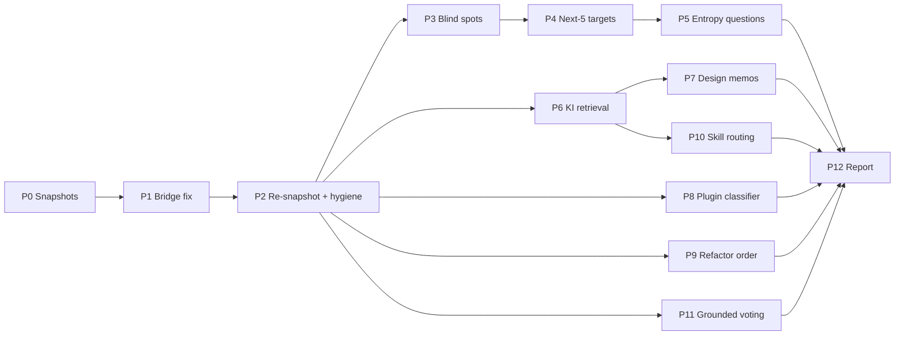

# Ontology-Spider Decision Experiments — Phased Plan

> **Audience:** a coding agent (lower-tier model) executing top-to-bottom, left-to-right.
> **Planner notes** are written so each step is mechanical. Where judgement is needed, the step is marked
> 🧑 **HUMAN CHECKPOINT** (stop and wait) or ⚠️ **ESCALATE** (hand back to a high-reasoning model).

---

## 0. How to Use This Plan (read every session)

### Resume protocol
1. Open this file. Find the **first unchecked box** in the Progress Tracker (§1).
2. Go to that phase. Inside it, find the first unchecked step box. Resume there.
3. Before resuming, verify the phase's **Inputs** exist on disk. If an input is missing, the previous phase is
   not really done — uncheck it and redo its missing step.
4. Every step is **idempotent**: re-running it overwrites its own output files. It is always safe to redo the
   step you were on.
5. Tick a box (`- [ ]` → `- [x]`) **only after** its acceptance check passes. Tick the phase in §1 only after
   **all** of its steps and its Acceptance section pass.
6. At the end of every phase: append an entry to `experiments/spider_decisions/RESULTS_LOG.md` (template in
   Phase 0) and make a **local** commit `exp(spider): phase N <title>`. **Do not push** unless the user asks.

### Hard rules (from `AGENTS.md` — non-negotiable)
- **Never** edit `.harness/knowledge/**` (Knowledge Items) unless a step explicitly says so **and** a
  🧑 HUMAN CHECKPOINT has approved the exact change.
- **Never** read, print, or log `D:\GitHub\projects\Tokens\tokens.txt`. No network calls are needed for this plan.
- **Never** run multi-line Python via `python -c`. Write a script file and run it (Rule 29).
- Every script begins with UTF-8 stream reconfiguration and `sys.path` setup (Rule 50) — use `common.py` (Phase 0).
- When saving machine-parsed output from PowerShell, use `| Out-File -Encoding utf8`, never bare `>` (Rule 26).
- Use `pytest -k "<pattern>"` or explicit file lists, never `tests/test_*.py` globs (Rule 30).
- Result record types are `@dataclass(slots=True, frozen=True)` (Rule 12).
- Do not modify `src/harness/kernel/**`.
- Experiments are **read-only observers** of external repos under `D:\GitHub\cloned\**`. Never write there.

### Standard commands
```powershell
# Python interpreter (always)
.venv\Scripts\python.exe <script>

# Spider CLI runner
.venv\Scripts\python.exe .agents/skills/ontology-spider/scripts/ontology_spider_runner.py --help

# Quality gates (run at end of every phase that changes code)
.venv\Scripts\python.exe -m ruff check .
.venv\Scripts\python.exe -m ruff format --check experiments/spider_decisions
.venv\Scripts\python.exe -m pytest tests/test_repo_ontology_seam.py tests/test_ontology_spider_service.py tests/test_ontology_spider_adapter_fixes.py -q
```

### ⚠️ Escalation triggers (stop and hand back to a high-reasoning model)
- A spider API call raises an exception you cannot fix by correcting arguments.
- Any pre-existing test fails after your change and the cause is not obvious within 2 attempts.
- A metric comes out wildly different from the "Expected range" given in a phase (it may be a bug, or a finding).
- You feel the need to change the scoring formula, ground truth, or acceptance threshold.

---

## 1. Progress Tracker

- [x] **Phase 0** — Scaffolding, shared helpers & frozen snapshots
- [x] **Phase 1** — False-bridge audit & fix (use case #8)
- [x] **Phase 2** — Re-snapshot after fix + vault hygiene: duplicates (#9) & unverified-KI priority (#7)
- [x] **Phase 3** — Domain blind-spot analysis (#2)
- [x] **Phase 4** — Next-5 learning targets (#1)
- [x] **Phase 5** — Entropy-driven question selection (#3)
- [x] **Phase 6** — KI retrieval for a code change (#4)
- [ ] **Phase 7** — Design-choice arbitration memos (#5)
- [ ] **Phase 8** — Plugin vs KI-only vs Skip classifier (#6)
- [ ] **Phase 9** — Brain Harness refactor ordering (#10)
- [ ] **Phase 10** — Spider-assisted skill routing vs `route_intent` (#11)
- [ ] **Phase 11** — Evidence-grounded swarm voting (#12)
- [ ] **Phase 12** — Final report & recommendations

### Why this order

- **Data quality first.** Phase 1 fixes `harness_learned` false positives. Every later phase that says
  "unlearned" (3, 4, 5, 8) depends on that flag being right.
- **Analysis before decisions.** Blind spots (3) feed target ranking (4), which feeds the candidate set for (5).
- **Retrieval before arbitration.** (6) builds the KI-retrieval function that (7) and (10) reuse.
- (8), (9), (11) are independent once Phase 2 is done; they are ordered cheapest-first.

---

## Phase 0 — Scaffolding, Shared Helpers & Frozen Snapshots

**Goal:** One shared helper module, a results layout, and cached JSON snapshots of every ontology model so later
phases load in seconds instead of re-scanning (google-research-master takes ~26 s to scan).

**Depends on:** nothing. **Model tier:** low.

### Steps
- [x] **0.1** Create directories:
  `experiments/spider_decisions/`, `experiments/spider_decisions/results/`, `experiments/spider_decisions/results/snapshots/`.
- [x] **0.2** Create `experiments/spider_decisions/__init__.py` (empty) and `experiments/spider_decisions/common.py`
  containing **exactly these public helpers** (implement them; keep the file ≤ 200 lines):
  - Constants: `WORKSPACE = Path(r"d:\GitHub\projects\Brain Harness")`, `VAULT = WORKSPACE / ".harness" / "knowledge"`,
    `EXP_DIR = WORKSPACE / "experiments" / "spider_decisions"`, `RESULTS = EXP_DIR / "results"`,
    `SNAPSHOTS = RESULTS / "snapshots"`, `GOOGLE_ROOT = Path(r"D:\GitHub\cloned\Google")`,
    `GRM_ROOT = GOOGLE_ROOT / "google-research-master"`, `AIRLLM_ROOT = Path(r"D:\GitHub\cloned\AIRLLM SUITE")`.
  - `bootstrap()` — reconfigures `sys.stdout`/`sys.stderr` to UTF-8 and inserts `WORKSPACE/"src"` and `WORKSPACE`
    at the front of `sys.path`. Every experiment script calls `bootstrap()` before other project imports.
  - `spider()` — returns `harness.services.ontology_spider.OntologySpiderKernelService()`.
  - `load_vault_model()` — returns `spider().load_vault(VAULT)`.
  - `load_repo_model(repo_path: Path, snapshot_name: str, *, refresh: bool = False, max_depth: int = 4, max_files_per_unit: int = 60)`
    — if `SNAPSHOTS/f"{snapshot_name}.json"` exists and not `refresh`, load it with
    `ontology_spider.api.load_model(path)`; otherwise build with `spider().load_repository_model(repo_path, vault_dir=VAULT, max_depth=..., max_files_per_unit=...)`,
    write `ontology_spider.api.export_model(model, "json")` to the snapshot path (UTF-8), and return the model.
  - `query(model, q: str) -> dict` — returns `spider().query_model(model, q)`.
  - `project_entities(model) -> dict[str, Mapping]` — `{eid: ent.attributes}` for entities whose attributes contain `"raw_name"`.
  - `write_json(phase: int, name: str, obj) -> Path` — writes `RESULTS/f"p{phase:02d}"/f"{name}.json"` (indent 2, UTF-8, `default=str`).
  - `write_md(phase: int, name: str, text: str) -> Path` — same, `.md`.
  - `append_log(phase: int, title: str, bullets: list[str])` — appends a dated section to `EXP_DIR/"RESULTS_LOG.md"`.
- [x] **0.3** Create `experiments/spider_decisions/RESULTS_LOG.md` with header `# Spider Decision Experiments — Results Log`
  and this per-phase entry template (as a comment for future appends):
  ```markdown
  ## Phase N — <title> (<ISO timestamp>)
  - Outcome: PASS | FAIL | PARTIAL
  - Key metric(s): ...
  - Finding(s): ...
  - Follow-ups: ...
  ```
- [x] **0.4** Create `experiments/spider_decisions/p00_snapshot.py` that builds/refreshes these snapshots
  (pass `refresh=True`) and prints entity/assertion counts for each:

  | snapshot_name | repo_path |
  |---|---|
  | `vault` | (use `load_vault_model()` and export it the same way) |
  | `google_portfolio_root` | `GOOGLE_ROOT` |
  | `grm` | `GRM_ROOT` |
  | `gvisor` | `GOOGLE_ROOT / "gvisor"` |
  | `airllm` | `AIRLLM_ROOT / "airllm"` |
  | `airllm_plus` | `AIRLLM_ROOT / "airllm-plus"` |
  | `brain_harness_src` | `WORKSPACE / "src" / "harness"` |

  Also write `write_json(0, "snapshot_manifest", {...})` with, per snapshot: entity count, assertion count, file
  size, and SHA-256 of the snapshot file.
- [x] **0.5** **Round-trip check** — create `experiments/spider_decisions/p00_roundtrip_check.py`: for each snapshot,
  rebuild live (no cache) and compare entity count, assertion count, and the set of `(subject, predicate, object)`
  triples with the cached JSON. Write `write_json(0, "roundtrip_check", ...)`.
  - If counts differ → ⚠️ **ESCALATE** (snapshots would silently corrupt every later phase).
- [x] **0.6** Run quality gates; append the Phase 0 entry to `RESULTS_LOG.md`; local commit.

### Outputs
`common.py`, `RESULTS_LOG.md`, `results/snapshots/*.json`, `results/p00/snapshot_manifest.json`, `results/p00/roundtrip_check.json`.

### Acceptance
- All 7 snapshots exist; round-trip check shows identical counts and triple sets.
- Expected ranges (from prior runs): `grm` ≈ 1,270 entities / ≈ 4,490 assertions; `vault` ≈ 630 entities / ≈ 959 assertions.

---

## Phase 1 — False-Bridge Audit & Fix (Use Case #8)

**Goal:** Measure how often `bridges_to_harness` / `harness_learned` is wrong, then fix the matcher in
`plugins/memory_and_epistemics/ontology_spider/repo_adapter.py` so weak, generic tag matches stop creating false bridges.

**Depends on:** Phase 0. **Model tier:** low for 1.1–1.3; the fix (1.4) is specified exactly below.

### Background (already-known defects)
| Repo unit | Wrongly bridged to | Why it is wrong |
|---|---|---|
| `airllm-plus/runtime` | `ki_agent_reach_layered_backend_fallback` | Generic tag `runtime`; unrelated project |
| `google-research-master/rpc` | `ki_20260831_openclaw_02` | Generic tag `rpc`; KI is about OpenClaw gateway |

Generic **unit names** also pollute "unlearned target" lists: `python`, `tests`, `scripts`, `test`, `go`, `js`,
`pkg`, `tools`, `docs`, `examples`, `bench`, `images`, `website`, `protos`, `data`, `eval`, `training`.

### Steps
- [x] **1.1** Create `p01_bridge_audit.py`. Using the Phase 0 snapshots `google_portfolio_root`, `grm`, `gvisor`,
  `airllm`, `airllm_plus`, collect **every** assertion with predicate `bridges_to_harness`. For each, record:
  snapshot, subject (unit id), object (KI id), unit `raw_name`, and the KI's `title`, `tags`, `source_target`
  (read from `VAULT/<ki_id>/metadata.json`; if the directory name differs from the id, search by `id` field).
  Write `write_json(1, "bridges_before", rows)`.
- [x] **1.2** Auto-label each row with a **heuristic draft label** `likely_true` / `likely_false` / `unsure`:
  - `likely_true` if the unit `raw_name` (lowercased, `-`→`_`) appears in the KI's `source_target`, `source_uri`,
    `sources[].repo`, `sources[].path`, or as a full segment of the KI `id`.
  - `likely_false` if the only match is a tag **and** the unit name is in the generic list above or is ≤ 4 chars.
  - otherwise `unsure`.
  Write `write_md(1, "bridges_label_sheet", ...)` as a Markdown table with columns
  `# | snapshot | unit | ki_id | ki_title | draft_label | FINAL (fill: T/F)`.
- [x] **1.3** 🧑 **HUMAN CHECKPOINT** — Ask the user to fill the `FINAL` column (T/F) in
  `results/p01/bridges_label_sheet.md`. Stop until it is filled. Then parse it into `write_json(1, "bridges_ground_truth", ...)`.
  Compute **before-fix metrics**: total bridges, false-positive count, FP rate. Write `write_json(1, "metrics_before", ...)`.
- [x] **1.4** **Implement the fix** in `repo_adapter.py` (inspect the current code first; touch only what is listed):
  1. Make `_discover_vault_learned_projects` record **match strength** per token: return
     `dict[str, tuple[str, str]]` mapping token → `(ki_id, strength)` where `strength` is `"structured"` for tokens
     from `source_target`, `source_uri`, `source_repo`, `isnad.source_repo`, `sources[].repo`, `sources[].path`,
     `id`/`ki_id` slugs, and `plugins_scaffolded`; and `"tag"` for tokens from `tags`. If a token is seen with both,
     keep `"structured"`.
  2. Add module constant `_GENERIC_UNIT_NAMES = frozenset({...})` with the generic list above.
  3. Update `_lookup_learned_ki` to return `(ki_id, strength) | None` and to **reject** a `"tag"` match when the unit
     name (normalized) is in `_GENERIC_UNIT_NAMES` or has length ≤ 4.
  4. In `RepoOntologyModelSource.load()`, add entity attributes `learned_match_strength` (`"structured"`, `"tag"`,
     or `"none"`) and `is_generic_unit` (`bool`). Keep all existing attributes and their names unchanged.
  5. In `src/harness/services/ontology_spider.py` `analyze_repository`, change the unlearned query to
     `query recommend research_project [has_tests=true, harness_learned=false, is_generic_unit=false]`.
  6. Update every caller of the changed helper signatures (search the repo for `_discover_vault_learned_projects`
     and `_lookup_learned_ki`, including `tests/`).
- [x] **1.5** Add tests to `tests/test_repo_ontology_seam.py`:
  - `test_generic_unit_tag_match_rejected` — a unit named `runtime` + a KI with tag `runtime` but unrelated
    `source_target` ⇒ `harness_learned is False`, `learned_match_strength == "none"`.
  - `test_structured_match_kept_for_generic_name` — a unit named `runtime` + a KI whose `source_target` ends in `/runtime`
    ⇒ `harness_learned is True`, strength `"structured"`.
  - `test_generic_units_excluded_from_unlearned` — `tests`/`scripts` units with tests do **not** appear in
    `unlearned_tested_projects`.
- [x] **1.6** Run quality gates. All pre-existing tests must still pass.
- [x] **1.7** Create `p01_bridge_after.py`: rebuild the five snapshots **live with `refresh=True`**, re-collect bridges,
  join against `bridges_ground_truth.json`, compute **after-fix metrics** (FP count, FP rate, and **true-bridge
  recall** = true bridges still present / true bridges before). Write `write_json(1, "metrics_after", ...)` and a
  before/after table `write_md(1, "summary", ...)`.
- [x] **1.8** **Regression set** — confirm these units are still `harness_learned=True` after the fix (from Phase 0
  snapshots and earlier sessions): `gvisor` (portfolio root), `latent_programmer`, `active_selective_prediction`,
  `scann`, `cisc`, `gfsa`, `etcmodel`, `imp`, `uq_benchmark_2019` (grm), `air_llm` (airllm). Record pass/fail per unit
  in `summary.md`.
- [x] **1.9** Append log entry; local commit.

### Acceptance
- Both known false bridges are gone.
- FP rate after < FP rate before; true-bridge recall ≥ 0.95; all regression-set units still learned.
- All tests pass.

---

## Phase 2 — Re-Snapshot + Vault Hygiene: Duplicates (#9) & Unverified-KI Priority (#7)

**Goal:** Lock in post-fix snapshots, then produce two read-only decision lists for vault maintenance.

**Depends on:** Phase 1. **Model tier:** low.

### Steps
- [x] **2.1** Re-run `p00_snapshot.py` (refresh all) and `p00_roundtrip_check.py`. Copy the new manifest to
  `write_json(2, "snapshot_manifest_post_fix", ...)`. From here on, every phase loads snapshots with `refresh=False`.
- [x] **2.2** Create `p02_unverified_priority.py` (**#7**):
  - From `load_vault_model()`, list entities with `isnad_verified is False`.
  - For each, compute **in-degree** = number of assertions whose `object` is that entity id (use
    `model.get_incoming(eid)`), and list which KIs point to it.
  - Score = in-degree; tie-break by number of tags, then id. Rank descending.
  - Write `write_json(2, "unverified_priority", ranked)` and a top-20 table `write_md(2, "unverified_priority", ...)`.
- [x] **2.3** Create `p02_duplicates.py` (**#9**):
  - Load every `VAULT/*/metadata.json`. Candidate duplicate pairs are KI pairs that:
    (a) share the same non-empty normalized `source_target` **and** have tag Jaccard ≥ 0.5, **or**
    (b) have tag Jaccard ≥ 0.7 with ≥ 3 tags each.
  - Normalize `source_target` by lowercasing, stripping trailing `/`, and removing `https://github.com/` and `external/` prefixes.
  - Exclude pairs connected by an explicit `same_domain` / `related_to` edge (those are intentional siblings) — list
    them separately as `intentional_siblings`.
  - Write `write_json(2, "duplicate_candidates", ...)` and `write_md(2, "duplicate_review_sheet", ...)` with a
    `DECISION (merge / keep / supersede)` column.
- [x] **2.4** 🧑 **HUMAN CHECKPOINT** — Ask the user to review both sheets. **Do not edit any KI.** Record the user's
  decisions (if any) verbatim in `write_md(2, "human_decisions", ...)`. Executing merges is **out of scope** for this plan.
- [x] **2.5** Append log entry with: number of unverified KIs, top-5 priority ids, number of duplicate candidates,
  number the user confirmed. Local commit.

### Acceptance
- Post-fix snapshots exist and round-trip cleanly.
- `unverified_priority.json` contains exactly the vault's unverified count (expected ≈ 78).
- Duplicate sheet reviewed (decisions may be "none").

---

## Phase 3 — Domain Blind-Spot Analysis (#2)

**Goal:** Find research domains that are common in the scanned repos but thin in the Knowledge Vault.

**Depends on:** Phase 2. **Model tier:** low, plus one human checkpoint.

### Steps
- [x] **3.1** Create `p03_domain_map_draft.py`: list every distinct `category` value in the vault (with counts) and
  every distinct `domain_class` across snapshots `grm`, `google_portfolio_root`, `gvisor`, `airllm`, `airllm_plus`
  (with counts). Draft a mapping `vault category → domain_class` using simple keyword rules
  (e.g. category containing `security` → `privacy_fairness_safety_project`; `machine_learning` → `general_ml_project`;
  `nlp`/`llm` → `nlp_and_llm_project`; `infrastructure`/`runtime` → `systems_and_runtime_project`;
  `agent` → `agent_orchestration_project`; `data_engineering` → `optimization_and_compression_project` only if tags
  mention `vector`/`search`/`quantization`, else `unmapped`). Write `write_json(3, "domain_map_draft", ...)`.
- [x] **3.2** 🧑 **HUMAN CHECKPOINT** — Show the draft mapping as a table (`write_md(3, "domain_map_review", ...)`) and ask
  the user to correct it. Save the approved mapping to `write_json(3, "domain_map_final", ...)`.
- [x] **3.3** Create `p03_blind_spots.py`: for each `domain_class`, compute
  `repo_units` (count of non-generic project entities), `learned_units` (count with `harness_learned=true`),
  `vault_kis` (count of KIs mapped to it), and
  `gap_score = repo_units / (1 + vault_kis)`. Rank descending.
  Use the spider for counts, e.g. `query count recommend speech_and_audio_project [is_generic_unit=false]` and
  `query count recommend speech_and_audio_project [harness_learned=true]` on the `grm` snapshot.
  Write `write_json(3, "blind_spots", ...)` and `write_md(3, "blind_spots", ...)`.
- [x] **3.4** Append log entry (top-3 gaps + scores); local commit.

### Acceptance
- Every `domain_class` present in the snapshots has a row. Spider `count` results match a plain Python count over
  `project_entities()` (assert this in the script).

---

## Phase 4 — Next-5 Learning Targets (#1)

**Goal:** Decide the next 5 subprojects to learn and compare against human judgement and naive baselines.

**Depends on:** Phase 3. **Model tier:** low, with one blind human checkpoint **at the start**.

### Steps
- [x] **4.1** 🧑 **HUMAN CHECKPOINT (blind, do first)** — Before running anything, produce a candidate list (unit id,
  domain, framework, test count, py file count, arXiv yes/no) from the `grm` snapshot via
  `query recommend research_project [has_tests=true, has_arxiv=true, harness_learned=false, is_generic_unit=false]`
  and write it to `write_md(4, "candidates_for_human", ...)`, **sorted alphabetically** (no scores shown).
  Ask the user to pick their 5. Save to `write_json(4, "human_picks", ...)`. Do not show any ranking until saved.
- [x] **4.2** Create `p04_rank_targets.py`. For each candidate compute (all normalized to 0–1 by min-max across candidates):
  - `fan_in` = number of `depends_on_project` assertions whose object is the unit,
  - `domain_gap` = that unit's domain `gap_score` from Phase 3,
  - `test_depth` = `test_file_count`,
  - `size` = `py_file_count`.
  - `score = 0.35*domain_gap + 0.30*fan_in + 0.20*test_depth + 0.15*size`.
  Rank; write `write_json(4, "ranked_targets", ...)` (all candidates) and the top 5.
- [x] **4.3** Baselines (same script): `largest_5` (top `py_file_count`), `random_5` (seed `20261118`), `most_tests_5`.
- [x] **4.4** Metrics: overlap@5 of each method with `human_picks`; number of **distinct domains** covered by each
  top-5; sum of `domain_gap` covered. Write `write_md(4, "comparison", ...)`.
- [x] **4.5** Append log entry; local commit.

### Acceptance
- Ranked list covers all candidates (expected ≈ 127 before Phase 1; may shrink slightly after).
- Comparison table present. **There is no pass/fail threshold on overlap** — record it as a finding.

---

## Phase 5 — Entropy-Driven Question Selection (#3)

**Goal:** Test whether `rank_attributes` picks better clarifying questions than random order when narrowing a set.

**Depends on:** Phase 4. **Model tier:** low.

### Steps
- [x] **5.1** Create `p05_entropy_questions.py`. Candidate set = top 20 from `ranked_targets.json`.
- [x] **5.2** For each candidate as the hidden target, simulate:
  - **Entropy policy:** repeatedly call `spider().rank_attributes(<grm snapshot path or model>, candidate_ids=<remaining>)`,
    take the highest-`classification_score` attribute with `is_identifier_like == False` and not in
    `{"raw_name", "learned_ki_id"}`, "ask" it (look up the target's value), filter remaining candidates to that value.
    Stop when 1 remains or no informative attribute is left.
    *If `rank_attributes` only accepts a vault source, call `ontology_spider.api.rank_discriminating_attributes(model, candidate_ids)` directly.*
  - **Random policy:** same loop, but pick a random eligible attribute (seed `20261118 + index`).
  - Record questions asked and whether the target was uniquely identified.
- [x] **5.3** Metrics: mean and max questions per policy; % uniquely identified. Write `write_json(5, "results", ...)`, `write_md(5, "summary", ...)`.
- [x] **5.4** Append log entry; local commit.

### Acceptance
- Both policies run on all 20 targets. **Expected:** entropy mean ≤ random mean. If entropy is worse, ⚠️ ESCALATE before logging.

---

## Phase 6 — KI Retrieval for a Code Change (#4)

**Goal:** Given a Brain Harness module, retrieve the KIs that should inform a change to it; measure precision/recall.

**Depends on:** Phase 2. **Model tier:** low for code; human checkpoint for the answer key.

### Target modules
`harness.services.vector_index`, `harness.services.uncertainty_guard`, `harness.agent.swarm.consensus`,
`harness.services.ontology_spider`, `harness.services.deep_auditor`.

### Steps
- [x] **6.1** Create `p06_answer_key_draft.py`: for each module, list KIs that mention it anywhere (case-insensitive
  substring of the dotted path **or** its last segment, e.g. `vector_index`) in `metadata.json` or `summary.md`.
  Write `write_md(6, "answer_key_sheet", ...)` with columns `module | ki_id | ki_title | where_mentioned | RELEVANT (Y/N)`.
- [x] **6.2** 🧑 **HUMAN CHECKPOINT** — Ask the user to fill `RELEVANT`, and to add any KI they know is relevant but
  missing. Save to `write_json(6, "answer_key", ...)`.
- [x] **6.3** Create `experiments/spider_decisions/retrieval.py` with
  `retrieve_kis(vault_model, module_dotted: str, *, hops: int = 1) -> list[tuple[str, int, str]]` returning
  `(ki_id, hop_distance, via_predicate)`:
  - Hop 0: KIs with a `references_code` assertion whose object equals the sanitized module id
    (dots → underscores; also try with a `plugins_` prefix variant if present in the model).
  - Hop 1: KIs connected to a hop-0 KI by `related_to` or `same_domain` (either direction).
  - Deduplicate, keeping the minimum hop.
- [x] **6.4** Create `p06_eval_retrieval.py`: for each module compute precision, recall, and F1 of `retrieve_kis`
  at hops 0 and 1 vs the answer key. Baseline: the substring-grep list from 6.1 (before human filtering).
  Write `write_json(6, "metrics", ...)`, `write_md(6, "summary", ...)`.
- [x] **6.5** Edge-coverage finding: report how many answer-key KIs have **no** `references_code` edge at all
  (expected: many — this is the known sparsity). Propose (do **not** apply) a list of `references_code` edges to
  backfill in `write_md(6, "edge_backfill_proposal", ...)`.
- [x] **6.6** Append log entry; local commit.

### Acceptance
- Metrics computed for all 5 modules at both hop levels. Low recall is an acceptable **finding**, not a failure.

---

## Phase 7 — Design-Choice Arbitration Memos (#5)

**Goal:** Use retrieval + verification status to produce cited decision memos and score them.

**Depends on:** Phase 6. **Model tier:** ⚠️ memo **writing** needs a high-reasoning model; data gathering is low.

### Design questions
1. *"What eviction/prefetch policy should Brain Harness use for lazily-staged plugin artifacts?"*
   (expected relevant KIs include `ki_airllm_plus_superblock_prefetch_runtime`, `ki_airllm_layerwise_streaming_and_moe_expert_offload`).
2. *"How should `uncertainty_guard` decide to abstain or escalate to a human?"*
   (expected relevant KIs include `ki_google_research_aspest_active_selective_prediction`,
   `ki_google_research_uq_benchmark_2019_calibration_shift`, `ki_google_research_cisc_confidence_voting`).

### Steps
- [ ] **7.1** Create `p07_gather_evidence.py`: for each question, collect evidence KIs = the expected KIs above ∪
  `retrieve_kis(...)` results for the closest target module (Q1 → `harness.services.ontology_spider` is **not**
  relevant; use tag search for `prefetch`, `cache`, `lru`, `streaming`; Q2 → `harness.services.uncertainty_guard`).
  For each KI, extract every `isnad.claims[]` entry with `assertion`, `file`/`source_file`, `lines`, `verified`, and the KI's `isnad_verified`.
  Write `write_json(7, "evidence_q1", ...)`, `write_json(7, "evidence_q2", ...)`.
- [ ] **7.2** ⚠️ **ESCALATE** — Hand the two evidence files to a high-reasoning model to write
  `results/p07/memo_q1.md` and `memo_q2.md`. Each memo must: state a recommendation, cite every supporting claim by
  `ki_id` + claim text, mark which claims are verified, and list conflicts or gaps.
- [ ] **7.3** Create `p07_score_memos.py`: compute `% cited claims verified`, `# distinct KIs cited`,
  `# conflicts flagged` per memo by parsing the memo for `ki_` ids and cross-checking evidence JSON.
- [ ] **7.4** 🧑 **HUMAN CHECKPOINT** — Ask the user to rate each memo 1–5 for usefulness. Record in `write_json(7, "human_ratings", ...)`.
- [ ] **7.5** Append log entry; local commit.

### Acceptance
- Both memos exist, every `ki_` id cited exists in the vault, scores and ratings recorded.

---

## Phase 8 — Plugin vs KI-Only vs Skip Classifier (#6)

**Goal:** Check whether spider attributes predict how past repos were actually handled.

**Depends on:** Phase 2. **Model tier:** low, plus one human checkpoint.

### Steps
- [ ] **8.1** Create `p08_ground_truth_draft.py`: for each top-level repo in `google_portfolio_root` and `AIRLLM_ROOT`
  children, draft the actual outcome:
  - `plugin` if a directory under `plugins/**` contains the repo token (e.g. `magika`, `mantis`, `perfetto`,
    `google_adk`, `google_tunix`, `google_styleguide`) **or** a vault KI has a `became_plugin` edge naming it;
  - `ki_only` if a KI bridges to it but no plugin exists;
  - `skip` otherwise.
  Write `write_md(8, "ground_truth_sheet", ...)` with a `FINAL` column.
- [ ] **8.2** 🧑 **HUMAN CHECKPOINT** — User confirms/corrects `FINAL`. Save `write_json(8, "ground_truth", ...)`.
- [ ] **8.3** Create `p08_classify.py` implementing this rule classifier on each repo's dominant unit attributes
  (use the unit with the largest code-file count in that repo's snapshot or in `google_portfolio_root`):
  - `plugin` if `primary_language == "python"` **and** `has_tests` **and** `packaging in {"pyproject", "setup_py", "requirements"}`;
  - `ki_only` if `has_readme` and (`has_arxiv` or `primary_language != "python"`);
  - else `skip`.
  Compute accuracy and a 3×3 confusion matrix vs ground truth. Write `write_json(8, "results", ...)`, `write_md(8, "summary", ...)`.
- [ ] **8.4** Append log entry (accuracy + the most informative misclassification); local commit.

### Acceptance
- Every repo classified; confusion matrix present. No accuracy threshold — this is exploratory.

---

## Phase 9 — Brain Harness Refactor Ordering (#10)

**Goal:** Use the spider on our own codebase to propose a dependency-safe refactor order.

**Depends on:** Phase 2. **Model tier:** low for analysis; human review at the end.

### Steps
- [ ] **9.1** Create `p09_refactor_order.py` using snapshot `brain_harness_src` (units = subpackages of `src/harness`).
  Collect: dependency hubs (in-degree on `depends_on_project`), cycles (`ontology_spider.api.validate_model` →
  `cycle_violation`), and per-unit `py_file_count`.
- [ ] **9.2** Produce an order: (1) units in cycles first, ordered by cycle size; (2) then remaining units in
  **reverse topological order** (leaves first) using `depends_on_project`; tie-break by higher `py_file_count`.
  Also compute, per unit, **blast radius** = number of units that transitively depend on it, via
  `query count transitive depends_on_project from <unit>` on the **reversed** relation — if the spider only follows
  forward edges, compute reverse reachability in Python and note that in the summary.
- [ ] **9.3** Cross-check against existing KIs `ki_file_size_hotspots` and `ki_deepening_cycle_history`
  (read their `summary.md`): list units that appear in both the spider's top-10 and those KIs.
- [ ] **9.4** Write `write_json(9, "refactor_order", ...)`, `write_md(9, "summary", ...)`.
- [ ] **9.5** 🧑 **HUMAN CHECKPOINT** — User marks the order as sensible / not sensible with comments.
- [ ] **9.6** Append log entry; local commit.

### Acceptance
- Every unit appears exactly once in the order; cycles (if any) listed with their paths.

---

## Phase 10 — Spider-Assisted Skill Routing vs `route_intent` (#11)

**Goal:** Compare the existing skill router with a spider-assisted router on a fixed task set.

**Depends on:** Phase 6 (reuses retrieval ideas). **Model tier:** low; human checkpoint for the task set.

### Steps
- [ ] **10.1** Inspect `src/harness/services/skill_graph/routing.py`, `service/`, and `adapter.py` to find how to
  construct the registry/service that exposes `route_intent(intent: str, top_k: int = 3) -> dict` (returns
  `matches` and `recommended_chain`). Note the construction recipe in `write_md(10, "router_recipe", ...)`.
  If you cannot construct it without the kernel, ⚠️ ESCALATE.
- [ ] **10.2** Draft 20 task intents with an expected skill name from `.agents/skills/` (e.g.
  "audit this repository's architecture" → `deep-repo-auditor`; "find the next research project to learn" →
  `ontology-spider`; "reverse engineer this .pyc" → `rea-reverse-engineering`). Write `write_md(10, "task_set_sheet", ...)`.
- [ ] **10.3** 🧑 **HUMAN CHECKPOINT** — User approves/edits the 20 tasks and expected skills. Save `write_json(10, "task_set", ...)`.
- [ ] **10.4** Create `p10_routing_eval.py`:
  - **Baseline:** `route_intent(task, top_k=3)`; hit@1 and hit@3 vs expected skill (match on
    `match.get("skill_name") or match.get("name")` per `AGENTS.md` Rule 35).
  - **Spider-assisted:** tokenize the task (lowercase words ≥ 4 chars, drop stopwords); find vault KIs whose tags
    contain any token; follow their `became_plugin` / `references_code` edges and the KIs' `category`; map to a skill
    by name overlap with `.agents/skills/*` directory names. Rank skills by number of supporting KIs.
  - **Hybrid:** baseline top-3 re-ranked by adding +1 per supporting KI from the spider-assisted path.
  Write `write_json(10, "results", ...)`, `write_md(10, "summary", ...)` with hit@1/hit@3 for all three.
- [ ] **10.5** Append log entry; local commit.

### Acceptance
- All 20 tasks scored under all 3 methods. No threshold — record which tasks each method uniquely gets right.

---

## Phase 11 — Evidence-Grounded Swarm Voting (#12)

**Goal:** Test whether weighting swarm votes by verified-KI support changes CISC consensus outcomes in the right direction.

**Depends on:** Phase 2. **Model tier:** low.

### Steps
- [ ] **11.1** Read `tests/test_swarm_cisc_integration.py` to learn the exact vote dict shape accepted by
  `ConsensusEngine.evaluate_cisc_consensus(votes, *, normalization="softmax", temperature=2.5, only_tie_break=False, uncertainty_service=None)`
  in `src/harness/agent/swarm/consensus.py`, and the key holding the winning choice in its return dict. Note both in
  `write_md(11, "api_notes", ...)`.
- [ ] **11.2** Create `p11_grounded_voting.py` with 12 synthetic disputes. Each dispute has 2–3 answer choices; each
  choice is linked to a `ki_id` (or `None`). Build them from real KIs: e.g. choice A linked to a KI with
  `isnad_verified=True`, choice B linked to one with `isnad_verified=False` or `None`. Give the **unsupported**
  choice the plurality of raw votes and/or higher raw confidence in at least 8 of the 12 disputes. Define the
  **correct** answer as the verified-supported choice.
- [ ] **11.3** For each dispute compute:
  - **Raw:** `evaluate_cisc_consensus(votes)`.
  - **Grounded:** same votes, but each vote's confidence multiplied by `1.0` if its choice's KI is verified,
    `0.6` if unverified, `0.4` if no KI.
  Record the winner under each, and whether it is correct.
- [ ] **11.4** Metrics: accuracy (raw vs grounded), number of flips, number of flips toward correct.
  Write `write_json(11, "results", ...)`, `write_md(11, "summary", ...)`.
- [ ] **11.5** Append log entry; local commit.

### Acceptance
- 12 disputes evaluated both ways. **Expected:** grounded accuracy ≥ raw accuracy; any flip toward an *incorrect*
  answer is listed explicitly.

---

## Phase 12 — Final Report & Recommendations

**Goal:** One report summarizing every phase, plus concrete follow-up recommendations.

**Depends on:** Phases 5, 7, 8, 9, 10, 11. **Model tier:** ⚠️ high for writing the recommendations.

### Steps
- [ ] **12.1** Create `p12_collect.py` that reads every `results/pNN/*metrics*.json`, `*results*.json`, and `summary.md`
  and writes a single table of headline metrics to `write_json(12, "headline_metrics", ...)`.
- [ ] **12.2** ⚠️ **ESCALATE** — High-reasoning model writes `experiments/spider_decisions/REPORT.md`:
  per-phase outcome, headline metric, finding, and a prioritized list of improvements (e.g. edge backfill from
  Phase 6, matcher changes from Phase 1, routing hybrid from Phase 10), each with the evidence file it relies on.
- [ ] **12.3** Run all quality gates one final time.
- [ ] **12.4** Append final log entry; local commit. Tell the user the work is ready and **ask before pushing**.

### Acceptance
- `REPORT.md` cites a results file for every claim. All quality gates pass.
