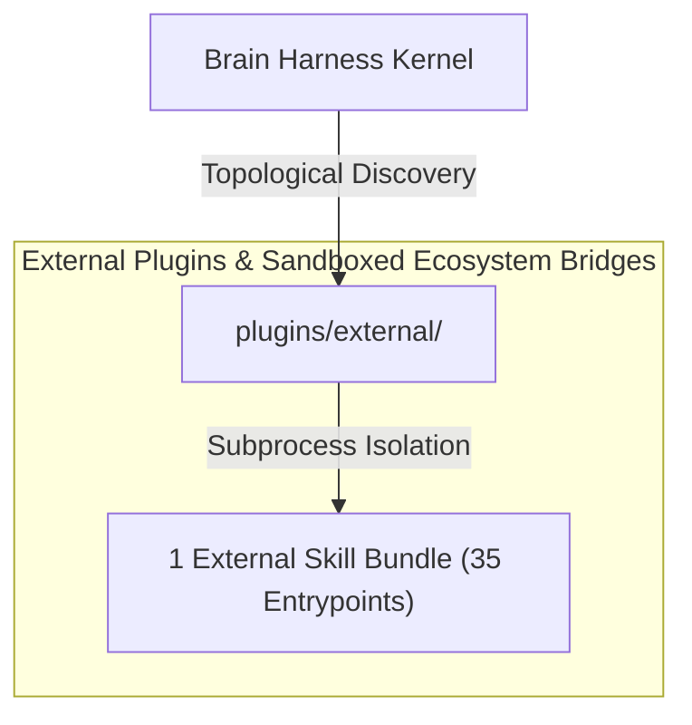

# 🌐 External Plugins & Sandboxed Ecosystem Bridges

Subprocess-sandboxed external community plugins, third-party agent skills, and isolated Python virtual environment execution boundaries.

---

## Category Architecture

Plugins within `external` adhere to the single-responsibility domain partitioning invariant (`Rule 18`). Each capability is encapsulated in a dedicated directory with independent manifests, isolation boundaries, and typed `ServiceKey[T]` declarations.



---

## Member Plugins Catalog

| Plugin | Isolation | Provided Services | Summary |
|---|---|---|---|
| [Pocock-skills-main](Pocock-skills-main/README.md) | `subprocess` | None | Pinned v1.2.3 (`2181519d`). Matt Pocock's agent skills bundle — 35 skill-prompt entrypoints (grilling, spec/ticket flows, TDD, code review, domain modelling). |

---

## Trust Review & Runtime Security Audit

A comprehensive code-verified security audit was conducted on `plugins/external/Pocock-skills-main/`:
1. **Manifest Configuration**:
   - Declares `name: "mattpocock-skills"`, `isolation: "subprocess"`, `trusted: false`, `sandbox_tier: "restricted-venv"`, and exposes 35 tool entrypoints.
2. **Runtime Mechanics (`skills_entrypoint.py:1-38`)**:
   - Every tool dispatches via module `__getattr__` to `_get_skill(skill_name, task, context)`.
   - The function performs **pure read-only `Path.glob("skills/**/SKILL.md")` lookups** within the vendored directory and returns a static JSON payload:
     `{"status": "ok", "skill": clean_name, "instructions": <markdown>, "task": task, "context": context}`.
3. **Security Verdict**:
   - Safe under existing `isolation: "subprocess"`, `trusted: false`, and `Rule 7` lazy staging.
   - `skills_entrypoint.py` imports only `pathlib.Path` and `typing.Any` — it executes **zero subprocesses, zero network calls, and zero filesystem writes**.
   - Individual upstream `SKILL.md` files provide instructional guidance; any subsequent tool invocations remain strictly governed by the Harness's own `ToolRegistry` and `CodexExecPolicyService`.

---

## Canonical Counting Rule

1. **Canonical Harness Plugins (134)**: Count only `plugins/<category>/<name>/plugin.json` at directory depth 3 where `category != "external"`.
2. **External Skill Bundles (1 bundle / 35 entrypoints)**: Count `plugins/external/<bundle>/plugin.json` separately as *"1 external skill bundle (35 skill-prompt entrypoints)"*.
3. **Excluded Nested Metadata**: Upstream metadata containing `.claude-plugin` (e.g., `plugins/external/Pocock-skills-main/.claude-plugin/plugin.json`) is excluded from all plugin scanners and test assertions.

---

## Opt-in Usage & Invocation

External skill prompts can be inspected or invoked via the Harness tool CLI:
```bash
# Inspect the ask_matt tool description
harness tool info plugin.mattpocock-skills.ask_matt

# View available entrypoints in the bundle
harness tool list --plugin plugin.mattpocock-skills
```

---

## Invariants & Execution Boundaries

1. Domain Partitioning (`Rule 18`): Plugins in `external` do not mix cross-domain concerns.
2. Typed Service Registration (`Rule 2`): All services register using typed `ServiceKey[T]` contracts.
3. Subprocess Isolation (`Rule 5` & `Rule 7`): Untrusted external dependencies execute in isolated subprocess sandboxes with lazy venv provisioning.
4. Zero-Fork Config (`Rule 44`): Baseline operational budgets reside in co-located `config.default.yaml`.
5. Version Pinning: All vendored external snapshots must carry a `.version_pin` and declared `source_commit`.
