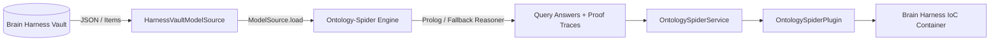

# Ontology-Spider Brain Harness Plugin

A domain-partitioned plugin integrating the **Ontology-Spider** ontological reasoning engine into Brain Harness (`memory_and_epistemics` category).

## Architecture

This plugin implements the thin adapter layer across the `ModelSource` seam:



## Features

- **Seam Boundary**: Zero brain-harness code is imported by `ontology_spider`. The adapter lives entirely inside this plugin and depends on the engine.
- **Transitive Reasoning**: Multi-hop reachability over typed edges (`depends_on`, `subclass_of`, etc.).
- **Proof Explanations**: Answers include complete graph paths and inference rule audit logs.
- **Dual-Mode Execution**: High-performance reasoning via SWI-Prolog with automatic pure-Python fallback.

## Installation & Engine Dependency

The plugin integrates the external **Ontology-Spider** engine (`ontology-spider>=0.2.0`). When the engine is not installed, the plugin gracefully initializes and registers in the IoC container in offline/stub mode; invoking queries or validations will surface an informative `RuntimeError` naming the installation steps.

To install the engine:

```bash
# Editable install from local checkout:
pip install -e /path/to/Ontology-Spider

# Or from Git repository:
pip install git+https://github.com/SpectreDeath/Ontology-Spider.git
```

## Testing

With or without the engine installed:

```bash
pytest plugins/memory_and_epistemics/ontology_spider/test_ontology_spider_plugin.py -v
```

- When the engine is absent: engine-dependent tests cleanly skip with a clear reason message, and offline IoC registration and error message tests pass.
- When the engine is installed: all 8 tests pass including transitive reachability, proof explanations, cycle detection, and zero-leakage AST verification.
