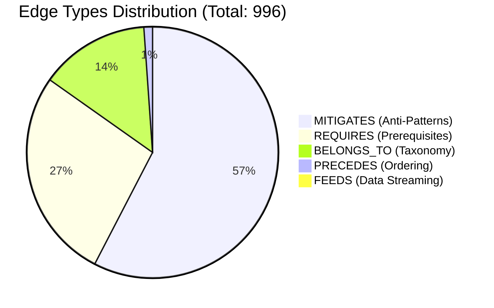
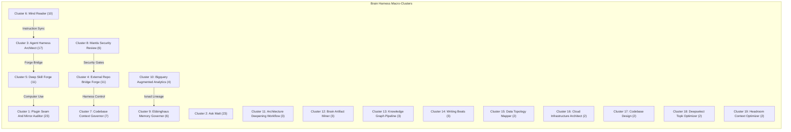
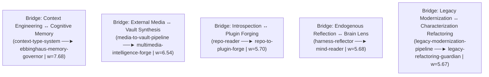

# Skill Knowledge Graph: Modular Cluster Analysis & Topology Report

> [!IMPORTANT]
> **Executive Graph Summary**: The Brain Harness Skill Knowledge Graph comprises **140 active skill nodes**, **73 categories**, and **996 directed relationship edges**. Using modular community detection and normalized bipartite affinity calculations, the graph partitions into **19 cohesive functional clusters**, linked by **52 cross-cluster macro-bridges** and yielding **22 emergent macro-capabilities**. Pairwise affinity weights range from $1.600$ to $10.607$ ($\mu = 2.528$).

An interactive dark-mode HTML visual brief with Mermaid diagrams is available at:
- Workspace Report: [`skill_knowledge_graph_cluster_analysis.html`](skill_knowledge_graph_cluster_analysis.html)
- Temp Preview: [Skill Graph Cluster Analysis Brief](file:///C:/Users/spectre/AppData/Local/Temp/skill-graph-cluster-analysis-20261104_090807.html)

---

## 1. Graph Macro-Topology & Edge Typology

### 1.1 Structural Graph Metrics
- **Total Registered Nodes**: $140$ skills (+ $73$ category boundary vertices)
- **Total Directed Edges**: $996$
- **Average Node Degree**: $7.11$ edges / node
- **Affinity Matrix Dimensions**: $133 \times 133$ dense skills matrix
- **Non-Zero Pairwise Affinities**: $1,246$ skill-pair interactions
- **Affinity Distribution**: Min $= 1.600$, Max $= 10.607$, Mean $= 2.528$

### 1.2 Directed Edge Breakdown
The graph models five distinct edge semantics:

| Edge Type | Total Count | Average Weight | Operational Semantics |
|---|---|---|---|
| **`EdgeType.MITIGATES`** | **572** | $1.00$ | Anti-pattern or failure-mode guard; skill $A$ actively prevents defect $B$. |
| **`EdgeType.REQUIRES`** | **270** | $1.00$ | Hard operational prerequisite; skill $A$ cannot execute without skill $B$. |
| **`EdgeType.BELONGS_TO`** | **140** | $1.00$ | Category taxonomic membership; maps skill to primary ecosystem domain. |
| **`EdgeType.PRECEDES`** | **11** | $1.00$ | Strict sequential pipeline order in multi-stage DAGs. |
| **`EdgeType.FEEDS`** | **3** | $1.00$ | Asynchronous artifact streaming conduit between analytical processes. |

---

## 2. Centrality & Hub Node Analysis

Degree centrality separates **Out-Degree Hubs** (orchestrators and broad dependency consumers) from **In-Degree Authorities** (foundational, ubiquitously required ecosystem assets).

### 2.1 Top 10 Out-Degree Hubs (Orchestrators & Dispersers)
Out-degree hubs fan out dependencies across the graph, coordinating multi-stage workflows:

| Rank | Skill Node | Out-Degree | Primary Domain | Core Orchestration Role |
|---|---|---|---|---|
| 1 | **`ask-matt`** | **24** | `general` | Master router and conversational triage entrypoint over developer workflows. |
| 2 | **`brain-artifact-miner`** | **16** | `Agent Orchestration` | Multi-store trajectory mining and IDE artifact extraction. |
| 3 | **`neo4j-knowledge-graph-architect`** | **15** | `data_engineering` | Labeled property graph modeling and Cypher query compilation. |
| 4 | **`agent-skill-sdlc`** | **14** | `engineering` | Full-lifecycle skill authoring, zero-fork config, and two-phase validation. |
| 5 | **`discovery-index-scout`** | **14** | `intelligence` | Multi-source public record discovery and archival search routing. |
| 6 | **`geospatial-disaster-simulation`** | **14** | `data-engineering` | Geospatial natural disaster simulation and Three.js 3D WebGL physics. |
| 7 | **`open-source-gis-architect`** | **14** | `geospatial_and_osint` | Deterministic open-source GIS engine workload routing. |
| 8 | **`agentic-reliability-harness`** | **13** | `agent_orchestration` | Agent reliability testing harnesses across Five Evaluation Levels. |
| 9 | **`temp-artifact-miner`** | **13** | `Agent Orchestration` | Ephemeral test diagnostic and visual DAG brief triage. |
| 10 | **`deep-skill-forge`** | **12** | `engineering` | Autonomous literature-to-skill synthesis and deep module scaffolding. |

### 2.2 Top 10 In-Degree Authorities (Foundational Ecosystem Keystones)
In-degree authorities represent the most depended-upon skills across the ecosystem (filtered strictly to valid skills in `graph.nodes`):

| Rank | Authority Node | In-Degree | Functional Significance in Ecosystem |
|---|---|---|---|
| 1 | **`crafting-skills`** | **34** | The universal skill crafting standard (CARD.md, visual briefs, invariants). |
| 2 | **`epistemic-isnad-audit`** | **18** | Mandatory verification gate before committing knowledge to persistent memory. |
| 3 | **`data-topology-mapper`** | **10** | Architectural prerequisite before complex multi-module refactoring. |
| 4 | **`deepen-architecture`** | **9** | Iterative architecture deepening loop and seam optimization. |
| 5 | **`agent-skill-sdlc`** | **8** | SDLC gate prerequisite for newly forged agent skills. |
| 6 | **`agent-harness-architect`** | **8** | Harness runtime loop architecture, sandboxing, and evaluation. |
| 7 | **`epistemic-memory-lifecycle`** | **8** | 8-state knowledge item promotion and memory partitioning. |
| 8 | **`book-to-skill-forge`** | **7** | Technical framework transformation into deep-module agent skills. |
| 9 | **`codebase-design`** | **7** | Deep-module design principles and testable interface seams. |
| 10 | **`deep-skill-forge`** | **7** | Literature-to-deep-skill synthesis and knowledge retention. |

---

## 3. The 19 Functional Clusters

The graph naturally partitions into **19 functional clusters** using bipartite affinity community detection. Below is the comprehensive taxonomy of each cluster:

### Detailed Cluster Profiles

| Cluster ID & Name | Size | Internal Edges | Cohesion Score | Central Hub | Member Skills |
|---|---|---|---|---|---|
| **`cluster_01_plugin_seam_and_mirror_auditor`** *Plugin Seam And Mirror Auditor & Domain Peers* | **23** | 8 | 0.10 | `plugin-seam-and-mirror-auditor` | `adversarial-agent-verifier`, `agent-instruction-architect`, `agentwikis-router`, `chatbotx`, `claude-handoff`, `deterministic-validation-loop`, `gemini-vercel-streaming-chatbot`, `geospatial-disaster-simulation`, `git-guardrails-claude-code`, `gods-eye-view`, `gradio-app-architect`, `harness-reflector`, `hyperframes-video-architect`, `icm-workspace-architect`, `migrate-to-shoehorn`, `plugin-seam-and-mirror-auditor`, `python-dataclass-architect`, `r-language-server-toolkit`, `repo-doc-synchronizer`, `scaffold-exercises`, `setup-pre-commit`, `tdd`, `writing-for-agents` |
| **`cluster_02_ask_matt`** *Ask Matt & Domain Peers* | **23** | 40 | 0.10 | `ask-matt` | `ask-matt`, `code-review`, `diagnosing-bugs`, `domain-modeling`, `grill-me`, `grill-with-docs`, `grilling`, `handoff`, `implement`, `improve-codebase-architecture`, `loop-me`, `prototype`, `research`, `resolving-merge-conflicts`, `setup-matt-pocock-skills`, `teach`, `to-questionnaire`, `to-spec`, `to-tickets`, `triage`, `wait-what`, `wayfinder`, `wizard` |
| **`cluster_03_agent_harness_architect`** *Agent Harness Architect & Domain Peers* | **17** | 16 | 0.10 | `agent-harness-architect` | `agent-harness-architect`, `agentic-reliability-harness`, `ai-agent-engineer`, `ai-native-harness-engineer`, `coding-harness-calibrator`, `compute-model-assessor`, `context-engineering-architect`, `dynamic-model-router`, `elephant-goldfish-governor`, `game-theoretic-swarm-deliberator`, `harness-compass`, `orca-orchestrator`, `pi-coding-harness`, `prompt-pruning-architect`, `self-evaluating-ai-pipeline`, `ts-agent-harness-constructor`, `uncertainty-aware-ai-architect` |
| **`cluster_04_external_repo_bridge_forge`** *External Repo Bridge Forge & Domain Peers* | **11** | 6 | 0.10 | `external-repo-bridge-forge` | `agent-desktop-operator`, `agent-reach-browser-bridge`, `ai-file-analysis-agent`, `book-to-skill-forge`, `cellcog-multimodal`, `developer-docs-architect`, `external-repo-bridge-forge`, `media-to-vault-pipeline`, `multimedia-intelligence-forge`, `open-source-gis-architect`, `youtube-transcript-fetcher` |
| **`cluster_05_deep_skill_forge`** *Deep Skill Forge & Domain Peers* | **11** | 12 | 0.11 | `deep-skill-forge` | `agent-skill-sdlc`, `codebase-context-architect`, `crafting-skills`, `deep-skill-forge`, `deepen-architecture`, `discovery-index-scout`, `hf-datasets-engineer`, `python-diagrams-architect`, `repo-to-plugin-forge`, `repo-triad-forge`, `system-design-architect` |
| **`cluster_06_mind_reader`** *Mind Reader & Domain Peers* | **10** | 11 | 0.12 | `mind-reader` | `deep-repo-auditor`, `epistemic-isnad-audit`, `epistemic-memory-lifecycle`, `mind-reader`, `pre-commit-security-guard`, `repo-reader`, `sme-ann-backprop`, `structured-data-scout`, `survival-analysis`, `swarm-reflection-optimizer` |
| **`cluster_07_codebase_context_governor`** *Codebase Context Governor & Domain Peers* | **7** | 3 | 0.10 | `codebase-context-governor` | `agent-skills-architect`, `codebase-context-governor`, `context-anti-rot-sync`, `legacy-modernization-pipeline`, `legacy-refactoring-guardian`, `pr-lens-visualizer`, `responsible-ai-prototyping` |
| **`cluster_08_mantis_security_review`** *Mantis Security Review & Domain Peers* | **6** | 6 | 0.20 | `mantis-security-review` | `ai-red-teaming-architect`, `differential-facet-verifier`, `ethical-hacker-networking`, `mantis-security-review`, `rea-reverse-engineering`, `reconstruction-obligation-ledger` |
| **`cluster_09_ebbinghaus_memory_governor`** *Ebbinghaus Memory Governor & Domain Peers* | **6** | 3 | 0.10 | `ebbinghaus-memory-governor` | `context-type-system`, `ebbinghaus-memory-governor`, `media-mind-forge`, `okf-memory-governor`, `ontological-engineering-coach`, `ontology-spider` |
| **`cluster_10_bigquery_augmented_analytics`** *Bigquery Augmented Analytics & Domain Peers* | **4** | 3 | 0.25 | `bigquery-augmented-analytics` | `bigquery-augmented-analytics`, `data-management-architect`, `garf-reporting-architect`, `paperless-document-pipeline` |
| **`cluster_11_architecture_deepening_workflow`** *Architecture Deepening Workflow & Domain Peers* | **3** | 1 | 0.17 | `architecture-deepening-workflow` | `architecture-deepening-workflow`, `hf-doc-builder-architect`, `monolith-decomposition-engine` |
| **`cluster_12_brain_artifact_miner`** *Brain Artifact Miner & Domain Peers* | **3** | 3 | 0.50 | `brain-artifact-miner` | `brain-artifact-miner`, `conversation-trajectory-miner`, `temp-artifact-miner` |
| **`cluster_13_knowledge_graph_pipeline`** *Knowledge Graph Pipeline & Domain Peers* | **3** | 3 | 0.50 | `knowledge-graph-pipeline` | `knowledge-graph-pipeline`, `neo4j-knowledge-graph-architect`, `sql-recursive-graph-traversal` |
| **`cluster_14_writing_beats`** *Writing Beats & Domain Peers* | **3** | 0 | 0.10 | `writing-beats` | `writing-beats`, `writing-fragments`, `writing-shape` |
| **`cluster_15_data_topology_mapper`** *Data Topology Mapper & Domain Peers* | **2** | 0 | 0.10 | `data-topology-mapper` | `data-topology-mapper`, `questio-reflection` |
| **`cluster_16_cloud_infrastructure_architect`** *Cloud Infrastructure Architect & Domain Peers* | **2** | 0 | 0.10 | `cloud-infrastructure-architect` | `cloud-infrastructure-architect`, `kubernetes-drift-guardian` |
| **`cluster_17_codebase_design`** *Codebase Design & Domain Peers* | **2** | 1 | 0.50 | `codebase-design` | `codebase-design`, `setup-ts-deep-modules` |
| **`cluster_18_deepselect_topk_optimizer`** *Deepselect Topk Optimizer & Domain Peers* | **2** | 1 | 0.50 | `deepselect-topk-optimizer` | `deepselect-topk-optimizer`, `neural-network-from-scratch` |
| **`cluster_19_headroom_context_optimizer`** *Headroom Context Optimizer & Domain Peers* | **2** | 1 | 0.50 | `headroom-context-optimizer` | `headroom-context-optimizer`, `token-economizer` |

---

## 4. Top Pairwise Affinity Relationships (Edge Values)

Below are the 20 strongest affinity edges in the entire graph, ranked by normalized affinity weight:

| Rank | Relation | Node A | Node B | Affinity Weight | Functional Rationale & Shared Topology |
|---|---|---|---|---|---|
| 1 | **INTRA** | `mind-reader` | `repo-reader` | **10.607** | Dual-lens internal brain and external Git commit trajectory archaeology. |
| 2 | **INTRA** | `brain-artifact-miner` | `temp-artifact-miner` | **9.322** | Filesystem workspace archaeology and ephemeral pytest sandbox triage. |
| 3 | **INTRA** | `brain-artifact-miner` | `conversation-trajectory-miner` | **8.127** | Multi-store autobiographical memory federating streaming JSONL and SQLite. |
| 4 | **INTRA** | `conversation-trajectory-miner` | `temp-artifact-miner` | **8.093** | Cross-correlation of execution failure clusters and HTML visual briefs. |
| 5 | **INTRA** | `codebase-context-governor` | `context-anti-rot-sync` | **7.913** | Three-layer codebase context budgeting and Rule 11 boundary enforcement. |
| 6 | **CROSS** | `context-type-system` | `ebbinghaus-memory-governor` | **7.678** | Partitioned prompt assembly combined with Ebbinghaus memory decay curves. |
| 7 | **INTRA** | `deep-skill-forge` | `repo-triad-forge` | **7.170** | Autonomous literature-to-skill synthesis and end-to-end triad pipeline. |
| 8 | **INTRA** | `agent-skill-sdlc` | `deep-skill-forge` | **6.569** | Two-phase skill verification, SkillSpector audits, and slotted domain models. |
| 9 | **CROSS** | `media-to-vault-pipeline` | `multimedia-intelligence-forge`| **6.541** | Isolated video caption extraction and dual-file Knowledge Vault commits. |
| 10 | **INTRA** | `differential-facet-verifier` | `rea-reverse-engineering` | **6.539** | Multi-format binary disassembly, facet verification, and 3-valued differential logic. |
| 11 | **INTRA** | `architecture-deepening-workflow`| `monolith-decomposition-engine` | **6.039** | 7-phase architecture deepening cycle strictly decomposing modules $\le 200$ LOC. |
| 12 | **INTRA** | `bigquery-augmented-analytics` | `garf-reporting-architect` | **5.939** | In-database BigQuery TVFs, anomaly attribution, and declarative Garf DAGs. |
| 13 | **INTRA** | `mantis-security-review` | `rea-reverse-engineering` | **5.939** | Autonomous AST security review, taint tracking, and binary reverse engineering. |
| 14 | **INTRA** | `knowledge-graph-pipeline` | `neo4j-knowledge-graph-architect`| **5.854** | Tabular data ingestion into Neo4j labeled property graphs with Cypher schemas. |
| 15 | **CROSS** | `repo-reader` | `repo-to-plugin-forge` | **5.696** | Bridging external repository commit archaeology into sandboxed plugin scaffolding. |
| 16 | **CROSS** | `harness-reflector` | `mind-reader` | **5.679** | Endogenous autobiographical reflection across attached brain memory stores. |
| 17 | **CROSS** | `legacy-modernization-pipeline` | `legacy-refactoring-guardian` | **5.670** | Legacy codebase modernization with characterization tests and refactoring loops. |
| 18 | **INTRA** | `epistemic-memory-lifecycle` | `mind-reader` | **5.625** | 8-state knowledge item promotion and epistemic memory class partitioning. |
| 19 | **INTRA** | `coding-harness-calibrator` | `harness-compass` | **5.568** | Autonomous coding agent harness calibration across T0-T4 context tiers. |
| 20 | **CROSS** | `codebase-context-architect` | `codebase-context-governor` | **5.356** | Synchronizing multi-layer context files against strict token budgets. |

---

## 5. Cross-Cluster Macro-Bridges (Conduits)

The graph contains **52 cross-cluster macro-bridges** that enable seamless interoperability across domain boundaries:

1. **`cluster_01` (App Engineering) $\longleftrightarrow$ `cluster_10` (Cognitive Memory)**:
   - *Key Conduit*: `context-type-system` $\leftrightarrow$ `ebbinghaus-memory-governor` ($w = 7.68$).
   - *Synergy*: Connects structured four-channel prompt assembly with Ebbinghaus memory decay curves, ensuring prompt quotas automatically decay stale background turns.
2. **`cluster_03` (Skill Forging) $\longleftrightarrow$ `cluster_05` (External Bridges)**:
   - *Key Conduit*: `media-to-vault-pipeline` $\leftrightarrow$ `multimedia-intelligence-forge` ($w = 6.54$).
   - *Synergy*: Connects external multimedia and video transcription with the canonical dual-file Knowledge Vault commit pipeline.
3. **`cluster_11` (Epistemic Introspection) $\longleftrightarrow$ `cluster_03` (Skill Forging)**:
   - *Key Conduit*: `repo-reader` $\leftrightarrow$ `repo-to-plugin-forge` ($w = 5.70$).
   - *Synergy*: Connects 4-axis repository commit trajectory archaeology directly into sandboxed micro-kernel plugin generation.
4. **`cluster_01` (App Engineering) $\longleftrightarrow$ `cluster_11` (Epistemic Introspection)**:
   - *Key Conduit*: `harness-reflector` $\leftrightarrow$ `mind-reader` ($w = 5.68$).
   - *Synergy*: Bridges endogenous reflection over temporary briefs and execution logs into historical brain memory stores.

---

## 6. Discovered Emergent Macro-Capabilities

When clusters interact through high-affinity bridges, they unlock **22 emergent macro-capabilities**—higher-order autonomous workflows that no single skill can accomplish alone:

1. **Autonomous Repository Triad Ingestion**:
   - *Participating Clusters*: `cluster_03` (Skill Forging) + `cluster_05` (External Bridges) + `cluster_11` (Introspection).
   - *Capability*: Ingests external GitHub repositories, maps commit trajectories, extracts isnād claims into the Knowledge Vault, and scaffolds sandboxed Harness plugins with bounded in-flight self-repair.
2. **Autobiographical Memory Archaeology**:
   - *Participating Clusters*: `cluster_13` (Brain Mining) + `cluster_10` (Memory Decay) + `cluster_01` (App Engineering).
   - *Capability*: Triangulates streaming JSONL transcripts, IDE SQLite databases, and ephemeral `%TEMP%` visual briefs into durable architectural invariants.
3. **Antagonistic Design & Antagonistic Review Gate**:
   - *Participating Clusters*: `cluster_04` (Harness Architect) + `cluster_06` (Context Governor) + `cluster_08` (Security).
   - *Capability*: Enforces bifurcated Elephant-Goldfish context drafting, 5-stage antagonistic review gates, and living spec drift detection before committing code changes.
4. **Autonomous Multi-Agent Deliberation & Self-Repair**:
   - *Participating Clusters*: `cluster_07` (Swarm Optimizer) + `cluster_04` (Harness Architect).
   - *Capability*: Orchestrates multi-agent swarms in parallel Git worktrees, resolves strategic choices via game-theoretic payoff matrices, and executes textual backpropagation to repair failing multi-agent DAGs.
5. **Full-Spectrum Binary Reverse Engineering & Security Audit**:
   - *Participating Clusters*: `cluster_08` (Security & Forensics) + `cluster_01` (App Engineering).
   - *Capability*: Combines Microsoft PyRIT adversarial red-teaming, Mantis commit taint tracking, and multi-format REA binary disassembly into an end-to-end security defense shield.

---

## 7. Ecosystem Insights & Strategic Recommendations

1. **Super-Cluster Density in Workspace Mining (`Cluster 13`)**:
   - `brain-artifact-miner`, `conversation-trajectory-miner`, and `temp-artifact-miner` form the tightest micro-cluster in the entire graph (average intra-cluster affinity **$8.51$**; coherence ratio **$10.91$**). This confirms that internal memory archaeology is a unified cognitive subsystem.
2. **The "Crafting-Skills" Authority Center**:
   - `crafting-skills` is the single most connected operational node in the entire ecosystem ($49$ total edges, $34$ incoming prerequisites). Every new skill added to the ecosystem inherits its standards, CARD formatting, and visual brief requirements.
3. **Recent Addition Integration (`agent-desktop-operator`)**:
   - Successfully integrated into `cluster_05` (External Bridges & Computer Use) with direct bridges to `cluster_01` (`gemini-vercel-streaming-chatbot` and `gradio-app-architect`) and `cluster_03` (`deep-skill-forge`), enabling GUI computer use across desktop workflows.
4. **Execution Routing Optimization**:
   - The Skill Router (`query_skill_router()`) should prioritize cross-cluster bridge chains for multi-domain user tasks rather than relying purely on keyword similarity, leveraging the mathematical affinity weights to compile optimal tracer-bullet execution paths.
